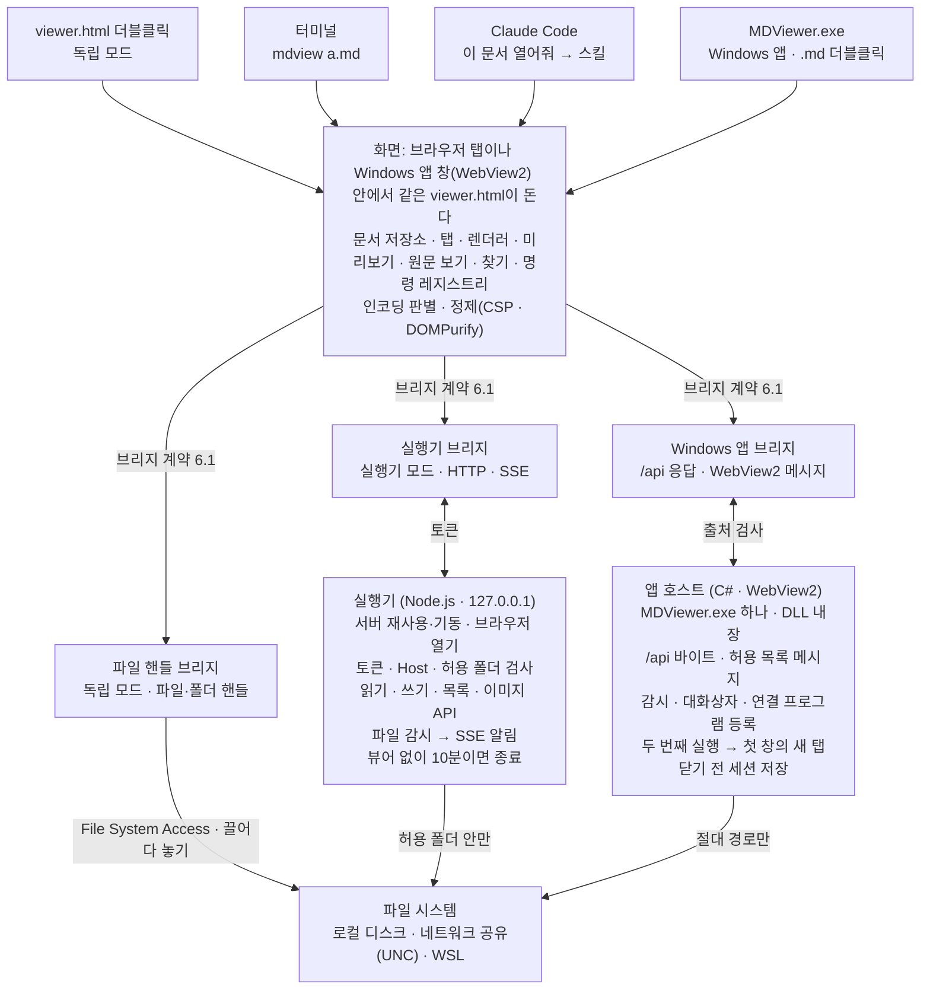
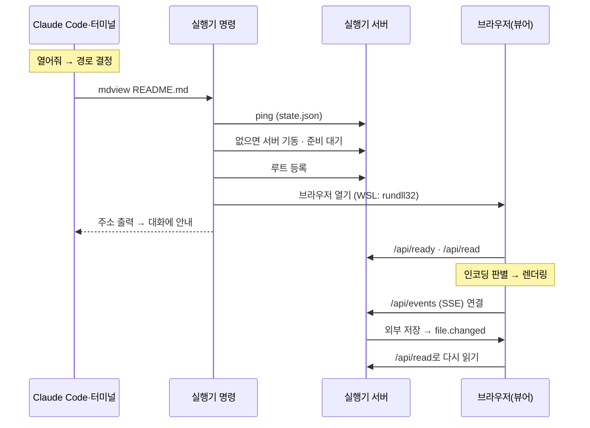

# 마크다운 뷰어 소프트웨어 설계 명세서 (SDD)

2026-10-30

## 1. 개요

이 SDD는 마크다운 뷰어 SRS v0.3의 v1.0·v1.1 범위를 어떻게 만들지 정한다. 뷰어는 TypeScript 화면을 HTML 파일 하나(`viewer.html`)로 묶고, 실행기는 Node.js 표준 라이브러리만 쓰는 스크립트 하나(`mdview.mjs`)로 만든다. v0.1의 C#·WebView2 호스트는 브리지 구현 두 개(파일 핸들 브리지, 실행기 브리지)로 바꾸고, 화면 코드는 그대로 다시 쓴다. v1.1의 Windows 앱(MDViewer.exe)은 그 호스트를 되살려 같은 viewer.html을 EXE 안에 넣고, 세 번째 브리지(Windows 앱 브리지)로 붙인다.

### 1.1 설계 범위

- SRS 필수 기능 32개, 비기능 요구사항 전부(NFR-USE-04 제외), ARCH-01~07.
- 비용이 낮아 v1.0에 앞당긴 권장 항목: FR-VIEW-05 스크롤 동기화, FR-REN-05 각주·제목 앵커, FR-FILE-07 UNC·WSL 경로(실행기), FR-FILE-08 텍스트 파일, FR-INFO-03 경로 복사·탐색기에서 열기(실행기), FR-LAUNCH-05 스킬 설치 명령.
- v1.1: Windows 앱 FR-DESK-01~05. 호스트 모듈(4장), 호스트 주소·메시지(6.4), 기동·닫기 흐름(7.6).
- 그 밖의 권장·선택 항목은 명령 이름만 예약하고 구현하지 않는다.

### 1.2 기술 스택

| 계층 | 선택 | 이유 |
| --- | --- | --- |
| 뷰어 화면 | TypeScript, esbuild로 묶어 `viewer.html` 하나에 인라인 | 더블클릭으로 열리고, CDN 없이 오프라인 동작(SRS 2.4) |
| 원문 보기 | CodeMirror 6, 읽기 전용을 compartment로 둠. 함수로 감싸 처음 쓸 때 실행 | 편집 단계에서 그대로 편집기(ARCH-02), 시작 비용 절감 |
| Markdown | markdown-it + task-lists·footnote 플러그인 | CommonMark 준수, 토큰마다 원문 줄 범위(ARCH-03) |
| 코드 강조 | highlight.js common 언어 묶음(36종) | 20종 이상(FR-REN-02) |
| HTML 정제 | DOMPurify, 허용 목록 방식 | NFR-SEC-01 |
| 파일 읽기(독립 모드) | File System Access API 핸들, 끌어다 놓기(`getAsFileSystemHandle`, `webkitGetAsEntry`), 없으면 `<input type=file>` | Edge·Chrome은 폴더·감시·세션까지, 그 밖의 브라우저는 파일만 |
| 실행기 | Node.js 18+ 표준 모듈(http, fs, child_process)만. TypeScript를 esbuild로 `mdview.mjs` 하나로 묶음 | 설치할 패키지 없음(SRS 2.4) |
| Windows 앱 | C# 5(.NET Framework 4.8의 csc) WinForms + WebView2 SDK 1.0.4258.31. viewer.html과 SDK DLL을 리소스로 넣은 EXE 하나 | Windows 10/11 기본 구성만으로 돈다(설치 없음). csc가 Windows에 들어 있어 빌드 도구를 따로 받지 않는다 |
| 인코딩 | 브라우저 TextDecoder fatal 모드(utf-8, utf-16le/be, euc-kr = CP949) | 화면 한 곳에서 판별, 실행기는 바이트만 넘김 |
| 테스트 | node:test + jsdom(단위), C# 테스트 실행 파일(Windows 앱 단위), Windows Python Playwright + Edge·WebView2 CDP(E2E) | 시나리오·표본은 다시 쓰고, E2E 하네스는 새로 작성 |

### 1.3 용어

- 화면: 브라우저에서 도는 TypeScript 앱. 탭, 렌더링, 목차, 찾기, 명령을 맡는다.
- 브리지: 화면이 파일·OS 기능을 부르는 계약(6.1). 독립 모드는 파일 핸들 브리지, 실행기 모드는 실행기 브리지, Windows 앱은 Windows 앱 브리지가 구현한다.
- 실행기 서버: `mdview.mjs --serve`로 뜨는 로컬 HTTP 서버. 실행기 명령이 필요할 때 띄우고 다시 쓴다.
- Windows 앱 호스트: MDViewer.exe의 C# 코드(`host/`). 창과 WebView2를 띄우고, 문서 바이트·그림과 OS 일(대화상자·감시·저장·탐색기·연결 프로그램 등록)을 맡는다.
- 문서 위치: 문서를 가리키는 문자열(5.2). 실행기가 읽는 문서는 OS 절대 경로, 브라우저 핸들로 연 문서는 가상 경로 `mdv:/<루트 id>/<상대 경로>`.

## 2. SRS 검토 결과

SRS v0.2를 구현 관점에서 검토했고, 구현을 막는 문제는 없었다. 열려 있던 8가지를 아래처럼 정했다. v0.2가 기대는 전제(file:// 페이지의 파일 API·저장소·CP949 디코더, WSL 서버에 Windows 브라우저 접속)는 Edge 154에서 먼저 확인했다. SRS v0.3의 FR-DESK(Windows 앱)도 구현을 막는 문제가 없었고, v0.1 호스트 코드(커밋 b5901e1)를 되살려 만들었다(6.4, 7.6). SRS v0.4의 FR-REN-08(front matter 상자)은 렌더러에 블록 규칙 하나를 더해 넣었다(8.1). SRS v0.5의 FR-REN-07(Mermaid)은 압축한 번들을 처음 쓸 때 격리된 iframe(무대)에서 실행해 그리고, 결과 SVG를 전용 정제를 거쳐 본문에 넣는다(7.5, 8.1, 8.4). 문서가 넣은 바깥 주소가 그리는 동안 요청되는 길을 E2E가 찾아, 무대를 문서에서 iframe으로 옮겼다. SRS v0.6의 화면 배치(FR-NAV-01·02, FR-FILE-05, FR-SESS-02)는 목차 패널을 문서 오른쪽에 따로 두고, 탭 바 요소 하나를 왼쪽 패널 위 칸으로 옮겨 세로 목록으로 쓰는 방식으로 넣었다(4장, 5.4, 6.3). SRS v0.7의 편집기(FR-EDIT-01~10)는 v1.0부터 지킨 ARCH-01~07 덕에 구조를 바꾸지 않고 넣었다. 다만 코드를 읽어 보니 아래 표 뒤쪽 여섯 가지가 편집을 막거나 편집 내용을 날릴 수 있어 함께 고쳤다(5.1, 6.1~6.4, 7.7, 8.3~8.4).

| 항목 | 발견 | 처리 |
| --- | --- | --- |
| 독립 모드 상대 이미지(FR-REN-03) | 파일 하나만 열면 브라우저가 같은 폴더의 다른 파일 접근을 주지 않는다 | 이미지 자리에 안내를 두고 미리보기 위 띠에 "폴더 열기"를 둔다. 고른 폴더가 그 문서를 품으면(`resolve()`) 폴더 기준 위치로 다시 연다 |
| 실행기에서 열린 뷰어 탭 | 명령줄에서는 이미 열린 브라우저 탭을 앞으로 가져올 수 없다 | 실행기 명령은 늘 새 브라우저 탭을 열고, 실행기 서버만 다시 쓴다(FR-FILE-04) |
| 실행기가 읽을 수 있는 범위 | 서버가 아무 경로나 읽으면 문서 하나로 다른 파일을 엿볼 수 있다 | 허용 폴더(루트) 안만 읽는다. 루트 = `--root`, 없으면 파일이 든 git 저장소 루트, 아니면 파일 폴더 |
| `/x` 같은 절대 링크 | GitHub은 저장소 루트 기준으로 푼다 | 문서가 속한 루트 기준으로 푼다(실행기 루트, 독립 모드의 연 폴더) |
| 모드가 섞인 열기 | 실행기로 띄운 뷰어에서도 Ctrl+O·끌어다 놓기로 다른 파일을 열 수 있어야 한다 | 실행기 브리지가 파일 핸들 브리지를 품고, 위치 접두어(`mdv:`)로 갈라 보낸다 |
| 브라우저 단축키(SRS 4.2) | Ctrl+W·Ctrl+Tab 등은 페이지가 받을 수 없다 | SRS 4.2를 고쳐 Alt+W 등으로 바꿨다. 나머지는 keydown에서 막는다 |
| 세션 복원(독립 모드) | 새로 연 페이지는 핸들 권한이 prompt라 클릭 없이는 못 읽는다 | IndexedDB에 핸들을 두고, 빈 화면의 "이전 문서 다시 열기" 클릭 한 번에 권한을 받는다 |
| 실행기 토큰 노출 | 주소의 토큰이 원격 이미지 요청의 Referer로 새거나, 문서가 쓴 실행기 주소가 토큰 없이 파일을 엿볼 수 있다 | `no-referrer` 정책을 두고, 문서가 쓴 루프백 주소는 정제에서 지운다. 토큰은 화면만 주소에서 읽어 붙인다 |
| 편집기 상태(FR-EDIT-01) | 원문 보기 하나를 모든 탭이 같이 쓰고, 문서 버전이 오르면 편집기 상태를 통째로 다시 만든다(실행 취소 기록·선택·스크롤이 사라짐) | 문서마다 EditorState를 두고 탭을 바꿀 때 갈아 끼운다. 입력은 미리보기만 다시 그리는 별도 길로 보낸다(7.7) |
| 줄 끝(FR-EDIT-04) | 문서 모델 text는 원래 줄 끝(CRLF)을 담는데 CodeMirror는 LF로 바꾼다. 비교·저장이 어긋난다 | 읽을 때 text를 LF로 맞추고 줄 끝 개수를 따로 둔다. 저장할 때 다수결 줄 끝으로 되돌린다(8.3) |
| 자기 저장 메아리(FR-EDIT-09) | 세 모드의 감시가 모두 앱이 쓴 변경도 file.changed로 돌려준다. 그대로면 저장할 때마다 다시 읽거나 충돌로 오해한다 | 다시 읽은 본문이 마지막으로 저장한 본문(savedText)과 같으면 무시한다. 저장 중에 온 알림은 저장이 끝난 뒤 판단한다(7.7) |
| 닫기·다시 읽기 길(FR-EDIT-08) | 탭 닫기·다른 탭 모두 닫기·폴더 기준 다시 열기·뷰어 탭 넘겨받기가 묻지 않고 닫고, F5·인코딩 다시 열기·세션 복원이 디스크 내용으로 덮는다. Windows 앱은 app.closing 뒤 1초면 강제로 닫는다 | 닫는 길마다 확인을 달고, 문서 저장소가 고친 문서 덮어쓰기를 거부한다. Windows 앱은 고친 문서가 있는 동안 1초 타이머를 걸지 않고 화면이 닫기를 취소할 수 있다(6.4, 7.7) |
| 쓰기 경로(FR-EDIT-04, NFR-SEC-05) | 세 모드 어디에도 쓰기가 없다. 실행기 POST는 JSON 64 KB까지만 받고, Windows 앱은 허용 폴더 없이 아무 절대 경로나 읽는다. 독립 모드 핸들은 읽기 권한만 받는다 | 실행기는 날 바이트 POST /api/write(Origin·확장자 검사), Windows 앱은 읽어 준 파일·저장 대화상자 결과만 담은 쓰기 허용 집합, 독립 모드는 처음 저장할 때 readwrite 권한을 묻는다(6.1~6.4, 8.4) |
| CP949 저장(NFR-ENC-05) | 브라우저 TextEncoder는 UTF-8만, Node 표준 라이브러리도 CP949 인코더가 없다 | 처음 저장할 때 TextDecoder('euc-kr')로 두 바이트 쌍을 모두 풀어 역표를 만든다. 인코딩은 화면 한 곳에서 하고 브리지는 바이트만 쓴다(8.3) |

## 3. 아키텍처

화면은 브리지 하나만 보고, 브리지는 모드에 따라 셋 중 하나다. 파일 시스템에 닿는 길은 독립 모드에선 브라우저의 파일 핸들, 실행기 모드에선 실행기 서버, Windows 앱에선 앱 호스트 하나뿐이다.



*구조도: 화면은 브리지 하나만 보고, 파일에 닿는 길은 방식마다 하나다.*

- 화면 모듈은 v0.1과 같다(문서 저장소, 탭 관리자, 렌더러, 미리보기, 원문 보기, 명령 레지스트리). OS를 아는 코드는 브리지 세 개와 실행기, Windows 앱 호스트에만 있고, 실행기 안에서는 OS·WSL 판별과 프로세스 실행을 `os.ts` 한 곳에 모은다(NFR-PORT-02).
- 모드는 페이지 주소로 가린다. http(s) 주소에 `t` 인자가 있으면 실행기 브리지, Windows 앱의 가상 주소(https://app.mdview)면 Windows 앱 브리지, 그 밖(file:// 등)은 파일 핸들 브리지다. 실행기는 늘 `127.0.0.1` 주소를 만들고, `localhost`로 들어온 페이지 요청은 `127.0.0.1`로 돌려보낸다. 두 이름의 저장소(origin)가 갈리지 않게 하기 위해서다.
- 실행기 브리지는 파일 핸들 브리지를 품는다. `mdv:` 위치(Ctrl+O·끌어다 놓기로 연 파일)는 파일 핸들 브리지로, OS 경로는 실행기 서버로 보낸다.
- 인코딩 판별은 화면 한 곳에서 한다. 세 브리지 모두 원본 바이트를 넘긴다.
- 실행기 서버가 드는 상태는 허용 폴더 목록(state.json에도 저장), 감시 중인 파일, 연결된 뷰어 수뿐이다. 뷰어의 탭·설정은 브라우저 저장소에 있다.
- 실행기 하나에 뷰어 탭은 하나만 둔다(7.3). 탭마다 SSE 연결을 잡으면 브라우저의 호스트당 연결 한도(HTTP/1.1, 6개)를 금방 다 쓰고, 여러 탭이 같은 세션을 번갈아 덮기 때문이다.
- Windows 앱 호스트는 화면과 두 길로 이야기한다. 문서 바이트·그림은 같은 출처의 `/api/read`·`/api/file` 응답으로(실행기와 같은 모양), 대화상자·감시·저장·탐색기·두 번째 실행은 WebView2 메시지로 한다(6.4). 화면이 `chrome.webview`에 처음 닿으면 수백 ms 멈추므로, 첫 화면까지는 메시지를 쓰지 않는다(7.6).
- Windows 앱은 창 하나에 화면 하나다. 두 번째 실행은 창을 띄우지 않고 위치를 첫 창에 넘긴다. 실행기의 뷰어 탭 합치기는 필요 없다.

## 4. 모듈 설계

모듈은 화면 15개, 실행기 6개, 스킬 1개, Windows 앱 호스트 7개다. 화면 모듈은 브리지 세 개를 빼면 OS를 모르고, UI 문자열은 화면·실행기·호스트가 각자 문자열 표에서 가져온다(NFR-USE-02).

| 모듈 | 책임 | SRS ID | 파일 |
| --- | --- | --- | --- |
| 진입 | 모드 판별, 앱 시작 | 전체 | `web/src/main.ts` |
| 브리지 계약 | 요청 메서드·이벤트·기능 플래그, 오류 형식, 모드별 구현 고르기 | 전체 | `web/src/bridge/types.ts`, `web/src/bridge/index.ts` |
| 파일 핸들 브리지 | 파일·폴더 선택, 끌어다 놓기, 핸들 등록과 `mdv:` 위치, 1초 폴링 감시, IndexedDB 핸들 보관·정리, 이미지 blob 주소, 폴더 기준 다시 열기 | FR-FILE-01·06, FR-NAV-02, FR-WATCH-01, FR-SESS-01, FR-REN-03 | `web/src/bridge/local.ts` |
| 실행기 브리지 | fetch·EventSource로 실행기 API 호출, 토큰 첨부, 연결 끊김 표시, `mdv:` 위치는 파일 핸들 브리지로 넘김 | FR-LAUNCH-01, FR-WATCH-01~02, FR-INFO-03 | `web/src/bridge/server.ts` |
| Windows 앱 브리지 | #mdv-boot 시작 정보, /api/read·/api/file fetch, WebView2 메시지 요청·응답·이벤트(10초 제한, 대화상자 제외), 첫 화면 뒤 app.attach, 끌어다 놓은 File 객체 넘기기 | FR-DESK-01~05 | `web/src/bridge/host.ts` |
| 폴더 목록 규칙 | 문서만, 폴더 먼저, 숨김·node_modules 제외, 이름순. 바이트를 문서로 바꾸기, 이미지 종류(두 브리지 공통) | FR-NAV-02 | `web/src/bridge/listing.ts` |
| 인코딩 판별 | BOM·UTF-8·CP949 판별, 바이너리, 줄 끝, 수동 인코딩. 저장용 인코딩(UTF-16 직접 쓰기, CP949 역표, 못 쓰는 글자 찾기, 줄 끝 다수결) | NFR-ENC-01~03·05, FR-INFO-02, FR-EDIT-04 | `web/src/encoding.ts` |
| 명령 레지스트리 | 명령 ID·제목·단축키·처리기. 키 입력 해석(물리 키 기준)과 메뉴의 원천. 예약 명령 | NFR-USE-01, ARCH-05 | `web/src/commands.ts` |
| 문서 저장소 | 문서 모델 보관·갱신·구독 알림(내용·표시 두 종류). 편집 반영, 저장 기준(savedText)과 수정됨, 고친 문서 덮어쓰기 거부, 다른 이름으로 저장 뒤 위치 바꾸기 | ARCH-01, ARCH-06, FR-EDIT-02 | `web/src/docs.ts` |
| 탭 관리자 | 탭 순서, 활성 탭, 탭별 보기 상태, 닫은 탭 기록 | FR-FILE-02~05, FR-VIEW-01 | `web/src/tabs.ts` |
| 렌더러 | markdown-it 설정, 블록 단위 렌더링·실패 격리, GFM 확장(표 정렬·취소선·자동 링크·태그 필터), front matter 상자, Mermaid 다이어그램(무대 iframe·그리기 큐·캐시, diagrams.ts), 소스 맵, 제목 id, 위치(Windows·POSIX·mdv:), 정제와 주소 변환 | FR-REN, NFR-SEC-01~02, ARCH-03~04 | `web/src/render/*.ts` |
| 보기 | 미리보기(Shadow DOM, 찾기 강조, 링크 가로채기, 안내 띠), 원문 보기(CodeMirror. 문서별 편집 상태와 실행 취소 기록, 바꾸기, 고치지 않은 문서의 제자리 다시 읽기), 분할 동기화 | FR-VIEW, FR-FIND, FR-NAV-03, ARCH-02 | `web/src/views/*.ts`, `web/src/source-entry.ts` |
| 패널·화면 틀 | 목차 패널(오른쪽), 작업 공간 트리(왼쪽 패널 아래 칸), 메뉴 바, 탭 바(위쪽 줄 또는 왼쪽 패널 위 칸의 세로 목록: 요소 하나를 옮기고 vertical 클래스로 바꿈), 패널 경계선 끌기, 상태 표시줄(수정됨), 찾기 바(바꾸기 줄), 충돌 알림 띠, 인코딩 선택, 확대·테마 | FR-NAV-01~02, FR-FILE-05, FR-VIEW-03~04, FR-INFO-01~02 | `web/src/panels/*.ts`, `web/src/ui/*.ts` |
| 세션·문자열 | 세션·설정 직렬화, 500 ms 디바운스와 pagehide 즉시 저장, 세션 주인, 뷰어 탭 넘겨받기, 앱 조립, UI 문자열 표 | FR-SESS-01~02, FR-FILE-04, NFR-REL-02, NFR-USE-02 | `web/src/session.ts`, `web/src/app.ts`, `web/src/strings.ts` |
| 편집 조정자 | 편집기 → 문서 모델 반영(디바운스), 미리보기만 다시 그리기, 저장·다른 이름으로 저장·새 문서, 저장 확인(대체 문자·못 쓰는 글자·덮어쓰기), 자기 저장 메아리 거르기와 외부 변경 충돌, 닫기 확인(탭·창·뷰어 탭 넘겨받기), 자동 저장. CodeMirror는 지연 로드라 가져오지 않고 원문 보기 콜백으로만 다룬다 | FR-EDIT-01~10 | web/src/edit.ts |
| 실행기 명령 | 인자 해석(WSL의 Windows 경로 변환), 루트 결정, 시작 잠금, 서버 재사용·기동, 브라우저 열기, `--stop`·`--status`·`--install-skill` | FR-LAUNCH-01·05, FR-FILE-04 | `launcher/cli.ts`, `launcher/main.ts` |
| 실행기 서버 | HTTP 라우팅, Host·토큰·허용 폴더 검사, 읽기·쓰기·목록·이미지·감시·로그 API(쓰기는 Origin·확장자 검사와 원자적 쓰기), 유휴 종료 | FR-LAUNCH-03, NFR-SEC-02·05, FR-EDIT-04 | `launcher/server.ts` |
| 감시 | 파일이 든 폴더를 fs.watch로 보고 파일 이름으로 거름(100 ms 디바운스, Windows·macOS는 대소문자 무시). 폴링이 필요한 경로는 300 ms 폴링 | FR-WATCH-01~02, NFR-PERF-04 | `launcher/watch.ts` |
| 상태·로그 | `~/.mdview/state.json`(포트·토큰·pid·허용 폴더, 0600), `start.lock`, `logs/mdview.log` 1 MB × 3 순환 | NFR-REL-03, NFR-ENC-04 | `launcher/state.ts`, `launcher/log.ts` |
| OS 연동 | 브라우저 열기·탐색기에서 보기(셸 없이), WSL·Windows 드라이브(/mnt)·UNC 판별, wslpath 변환 | FR-LAUNCH-04, FR-INFO-03, NFR-PORT-02 | `launcher/os.ts` |
| 실행기 문자열 | 명령줄 메시지 표 | NFR-USE-02 | `launcher/strings.ts` |
| Claude Code 스킬 | 요청에서 대상 경로를 정하고 실행기를 불러 결과를 알림 | FR-LAUNCH-02 | `skill/SKILL.md` |
| 앱 진입·내장 파일 | 인자(`--new-window`·`--register`·`--unregister`), 긴 경로 스위치, 리소스의 WebView2 DLL 적재(AssemblyResolve)와 로더 풀기, 런타임 확인 | FR-DESK-01·05 | `host/Program.cs`, `host/Embedded.cs` |
| 창 | WebView2 설정, https://app.mdview 응답(화면·시작 정보·/api), 탐색 막기, 컨텍스트 메뉴, 창 위치·제목 표시줄, 닫기 전 저장(고친 문서가 있으면 화면의 확인을 기다림), POST /api/write, 저장 대화상자 | FR-DESK-04·05, NFR-SEC-02 | `host/MainForm.cs` |
| 호스트 브리지 | 메시지 출처 검사, 허용 목록 메서드 처리, 응답·이벤트 보내기 | FR-DESK-01~04 | `host/Bridge.cs` |
| 파일·감시 | 절대 경로 정규화, 바이트·그림 읽기, 문서 쓰기(쓰기 허용 집합·확장자·원자적 교체), 폴더 목록, 연 공유만 그림 허용, FileSystemWatcher(150 ms 디바운스)와 WSL 경로 500 ms 폴링 | FR-FILE-07, FR-WATCH-01~02 | `host/FileService.cs`, `host/WatchService.cs` |
| 저장·로그·단일 인스턴스 | 저장 위치, 원자적 쓰기, 로그 1 MB × 3 순환, 시작 계측, 사용자별 Mutex와 Named Pipe | FR-DESK-02·04, NFR-REL-02~03, NFR-ENC-04 | `host/Storage.cs`, `host/SingleInstance.cs` |
| 앱 OS 연동 | 외부 주소 열기(http·https·mailto), 탐색기에서 보기, 폴더 대화상자, 연결 프로그램 등록·해제·확인 | FR-DESK-03, FR-INFO-03, FR-NAV-03 | `host/Shell.cs`, `host/OpenWith.cs` |
| 호스트 문자열 | 대화상자·오류·로그 문구 표 | NFR-USE-02 | `host/Strings.cs` |

## 5. 데이터 설계

파일 하나는 문서 모델 하나이고, 탭은 문서를 가리키는 보기 상태다. 스크롤 위치는 픽셀이 아니라 원문 줄 번호로 저장해, 확대·재렌더링·보기 전환 뒤에도 같은 위치로 돌아온다. v0.1과 달라진 것은 문서 위치의 형식과 저장 위치다.

### 5.1 문서 모델 (ARCH-01, ARCH-06)

```ts
interface DocModel {
  id: string;           // docKey(path): Windows 경로는 소문자, POSIX·mdv: 위치는 그대로
  path: string;         // 문서 위치(5.2)
  text: string;         // 줄 끝을 LF로 맞춘 본문(v2.0). 원래 줄 끝은 eol·eolCounts에
  encoding: 'utf-8' | 'utf-16le' | 'utf-16be' | 'cp949';
  hasBom: boolean;
  eol: 'CRLF' | 'LF' | 'CR' | 'Mixed' | 'None';
  eolCounts: { crlf: number; lf: number; cr: number }; // 저장할 때 다수결(v2.0)
  size: number;         // 디스크 바이트 수(저장하면 새 값)
  mtime: number;        // 디스크 수정 시각(저장 충돌 검사의 기준)
  decodeWarning: boolean;
  kind: 'markdown' | 'text';
  binary: boolean;      // 바이너리는 편집하지 않는다
  version: number;      // 본문이 바뀔 때마다 증가(렌더링 캐시 키)
  state: 'ok' | 'deleted';
  dirty: boolean;       // 수정됨(FR-EDIT-02)
  savedText: string;    // 마지막으로 읽거나 저장한 본문(LF). dirty 재계산·메아리 거르기 기준
  untitled: boolean;    // 새 문서(mdv:/n…, FR-EDIT-06)
  forcedEncoding?: Encoding;
  forcePreview?: boolean;
}
```

원본 바이트는 화면 메모리에 두지 않는다. 인코딩을 바꿔 다시 읽을 때(FR-INFO-02)는 브리지가 다시 읽는다. 탭 20개 메모리 목표(NFR-PERF-06) 때문이다.

v2.0에서 구독 알림을 세 종류로 나눴다. content는 디스크에서 읽은 본문이라 화면 전체(편집기 포함)를 다시 맞추고, edit는 편집기에서 고친 본문이라 편집 조정자가 미리보기·목차·상태 표시줄만 고친다(7.7). flags는 수정됨·삭제 표시만 바뀐 것이라 탭 바·창 제목·상태 표시줄만 고친다. 고친 문서는 디스크에서 다시 읽은 내용으로 덮지 않는다(upsert가 거부하고, 사용자가 버리기를 고른 때만 force). 선택·실행 취소 기록 같은 편집 상태는 문서 모델이 아니라 원문 보기가 문서마다 들고 있다.

### 5.2 문서 위치

| 어디서 연 문서 | 형식 | 예 | 대소문자 | 다시 열기 |
| --- | --- | --- | --- | --- |
| 실행기(Windows)·Windows 앱 | 드라이브·UNC 절대 경로 | `C:\docs\a.md`, `\\srv\share\a.md` | 구분 안 함 | 됨 |
| 실행기(WSL·macOS·Linux) | POSIX 절대 경로 | `/home/me/docs/a.md` | 구분 | 됨 |
| 폴더 핸들(d) | `mdv:/d<n>/<상대 경로>` | `mdv:/d1/guide/a.md` | 구분 | 핸들을 기억할 때 |
| 파일 핸들(f) | `mdv:/f<n>/<파일 이름>` | `mdv:/f2/a.md` | 구분 | 핸들을 기억할 때 |
| 핸들 없는 파일·폴더(u) | `mdv:/u<n>/<상대 경로>`. input으로 받은 파일, webkitdirectory 폴더 | `mdv:/u3/a.md` | 구분 | 안 됨 |
| 끌어다 놓은 폴더 항목(e) | `mdv:/e<n>/<상대 경로>`. webkitGetAsEntry(Edge·Chrome 밖 브라우저) | `mdv:/e4/a.md` | 구분 | 안 됨 |
| 새 문서(n, v2.0) | mdv:/n\<k>/제목 없음 \<k>.md. 파일이 없고 본문은 화면 메모리에만 있다 | mdv:/n1/제목 없음 1.md | 구분 | 안 됨. 세션·최근 목록·닫은 탭·감시에서 뺀다. 첫 저장이 다른 이름으로 저장이다 |

- 상대 링크·이미지는 문서 폴더 기준으로, `/x`는 문서가 속한 루트(실행기 허용 폴더, 핸들 폴더) 기준으로 푼다.
- 루트 밖을 가리키면 실행기는 403으로, 파일 핸들 브리지는 "열 수 없음"으로 답한다.
- 같은 파일은 같은 위치가 된다(FR-FILE-03). 새 파일 핸들은 이미 연 f 루트와 isSameEntry로, d 루트와 resolve()로 비교해 있으면 그 위치를 쓴다. 새 폴더 핸들도 isSameEntry로 같은 d 루트를 찾는다.
- 루트 번호는 localStorage(`mdv.rootSeq`)에 이어 세어 되풀이하지 않는다. 다시 열 수 없는 위치(u, e, 핸들을 기억하지 않을 때의 d·f)는 세션·최근 목록에 남기지 않는다.
- 화면에 보이는 이름은 브리지가 정한다. `mdv:` 위치는 `<폴더 이름>/<상대 경로>`로 보여준다.
- 핸들 없는 파일(u)은 인코딩을 바꿔 다시 읽을 수는 있지만(바뀌지 않은 File 객체를 다시 읽음), 감시·F5·삭제 표시는 없다.

### 5.3 탭 상태

```ts
interface TabState {
  docId: string;
  mode: 'preview' | 'source' | 'split';
  line: number;        // 화면 맨 위에 보이는 원문 줄(0부터)
  findTarget: 'preview' | 'source'; // 마지막 포커스
}
```

### 5.4 저장 위치

뷰어의 설정·세션은 브라우저 저장소에, 실행기의 상태·로그는 사용자 폴더의 `~/.mdview/`에 둔다. 모두 UTF-8 JSON이고 `schemaVersion`을 갖는다(ARCH-07).

| 데이터 | 위치 | 쓰는 쪽 | 내용 |
| --- | --- | --- | --- |
| 세션 | localStorage `mdv.session` | 화면 | 열린 탭(위치·모드·줄), 활성 탭, 작업 공간, 왼쪽 패널(sidePanel: 열림·너비·목록 높이)과 목차 패널(tocPanel: 열림·너비. v1.2의 sidePanel.tab은 버린다), 최근 파일 20·폴더 10. 다시 열 수 없는 위치는 뺀다 |
| 세션 주인 | localStorage `mdv.sessionOwner` | 화면 | 세션을 저장할 뷰어 탭 id. 포커스를 얻은 탭이 주인이 된다 |
| 설정 | localStorage `mdv.settings` | 화면 | 테마(light·dark·system), 확대 비율, 자동 줄 바꿈, 열린 파일 표시(openFiles: tabs·list, 기본 tabs), 원격 이미지 허용, 대용량 기준(5 MB), 핸들 기억(기본 켬), 단축키 재정의(v1.1 예약), 자동 저장(autoSave, 기본 끔. v2.0) |
| 루트 번호 | localStorage `mdv.rootSeq` | 파일 핸들 브리지 | 마지막으로 쓴 루트 번호 |
| 핸들 | IndexedDB `mdview` / `roots` | 파일 핸들 브리지 | 루트 id → 파일·폴더 핸들과 이름. 세션·최근 목록이 가리키는 것만 남기고, 핸들 기억을 끄면 모두 지운다 |
| 실행기 상태 | `~/.mdview/state.json` (0600) | 실행기 | 포트, 토큰, 서버 pid, 버전, 허용 폴더(최근 100개) |
| 시작 잠금 | `~/.mdview/start.lock` | 실행기 명령 | 서버 기동을 한 번에 하나로 묶는다. 10초 지난 잠금은 버린다 |
| 실행기 로그 | `~/.mdview/logs/mdview.log` | 실행기 | 오류·경고와 실행기 모드의 뷰어 오류. 1 MB에서 순환하며 3개 보관 |
| Windows 앱 설정·세션 | `%APPDATA%\MdViewer\` settings.json·session.json·window.json | Windows 앱 호스트 | 화면이 store.save로 보낸 설정·세션(위 행과 같은 내용)과 창 위치·크기. 임시 파일에 쓰고 바꾼다. 시작 때 화면에 #mdv-boot로 넘긴다 |
| Windows 앱 로그·데이터 | `%LOCALAPPDATA%\MdViewer\` logs\\mdview.log, WebView2\\, bin\\<버전>\\ | Windows 앱 호스트 | 로그 1 MB × 3 순환, WebView2 사용자 데이터(세션 주인을 담는 localStorage 포함), EXE에서 푼 WebView2Loader.dll |
| 연결 프로그램 등록 | `HKCU\Software\Classes` | Windows 앱 호스트 | MdViewer.Document, Applications\\\<EXE 이름>, .md·.markdown·.mdown·.mkd의 OpenWithProgids, SystemFileAssociations\\<확장자>\\shell\\MdViewer. 설정 메뉴·--register로 쓰고 --unregister로 지운다 |

- `~/.mdview`는 0700으로 만든다. 루프백은 같은 PC의 다른 사용자도 접속할 수 있어 토큰이 유일한 방어이기 때문이다.
- 실행기 모드의 localStorage는 `http://127.0.0.1:<포트>` origin에 묶인다. 그래서 실행기는 --port를 주지 않으면 지난 포트(기본 7787)를 다시 쓴다. 포트가 바뀌면 설정·세션은 처음부터 시작한다.
- 환경 변수 `MDVIEW_HOME`이 있으면 `~/.mdview` 대신 그 폴더를 쓴다(테스트 격리용).
- Windows 앱은 `MDVIEW_PROFILE_DIR`가 있으면 설정·로그·WebView2 데이터를 그 폴더 하나에, `MDVIEW_REGROOT`가 있으면 등록을 HKCU의 그 키 아래에 둔다(테스트 격리용). EXE 옆에 `portable.txt`가 있으면 설정·로그를 EXE 옆 `data\`에 둔다.

## 6. 인터페이스 설계

브리지는 화면이 부르는 비동기 메서드와 화면이 받는 이벤트의 묶음이다. 파일 핸들 브리지는 브라우저 API로 직접 처리하고, 실행기 브리지는 OS 경로를 HTTP·SSE로 실행기 서버에 넘긴다. Windows 앱 브리지는 바이트를 같은 출처의 /api 주소로 받고, 나머지는 WebView2 메시지로 앱 호스트에 넘긴다(6.4).

### 6.1 브리지 계약

| 메서드 | 매개변수 | 결과 | 파일 핸들 브리지 | 실행기 브리지 | Windows 앱 브리지 | SRS ID |
| --- | --- | --- | --- | --- | --- | --- |
| app.ready | 없음 | 시작 때 열 위치, 설정·세션, 모드, 버전, 허용 폴더, 권한을 다시 받을 루트 수 | localStorage, 저장한 핸들 | GET /api/ready + 주소의 `f`·`d` | index.html의 #mdv-boot(다시 읽은 페이지는 메시지 app.ready) | FR-FILE-01, FR-SESS-01 |
| file.read | path, encoding(선택) | 문서 모델 필드(5.1)에서 id·version·state 제외 | 핸들 getFile() → 판별 | GET /api/read 바이트 → 판별 | GET /api/read 바이트(호스트) → 판별 | FR-FILE-01, FR-INFO-02 |
| dir.list | path | 항목(이름·폴더 여부), 목록 규칙 적용 | 폴더 핸들 values() | GET /api/list | 메시지 dir.list | FR-NAV-02 |
| dialog.openFiles | 없음 | 연 위치 목록 | showOpenFilePicker, 없으면 input | 파일 핸들 브리지에 맡김 | 메시지(Windows 파일 대화상자, OS 경로) | FR-FILE-01 |
| dialog.openFolder | 없음 | 연 위치 또는 null | showDirectoryPicker, 없으면 input webkitdirectory | 파일 핸들 브리지에 맡김 | 메시지(Windows 폴더 대화상자) | FR-NAV-02 |
| watch.set | paths | 없음. 감시 대상을 통째 교체 | 1초 폴링(루트가 없는 위치는 건너뜀) | POST /api/watch | 메시지(FileSystemWatcher, WSL 경로는 500 ms 폴링) | FR-WATCH-01~02 |
| store.save | name(session·settings), data | 없음. 세션을 저장하면 쓰지 않는 핸들을 정리 | localStorage | localStorage | 메시지(%APPDATA%\\MdViewer의 JSON, UI 스레드에서 바로 씀) | FR-SESS-01, NFR-REL-02 |
| shell.openExternal | url | 없음. http·https·mailto가 아니면 거부 | window.open(noopener) | 같음 | 메시지(기본 브라우저) | FR-NAV-03 |
| shell.reveal | path | 없음 | 지원 안 함(ENOTSUP) | POST /api/reveal | 메시지(explorer /select) | FR-INFO-03 |
| session.restore | 없음 | 다시 연 루트 수 | 저장한 핸들에 requestPermission(클릭 안에서) | 파일 핸들 브리지에 맡김 | 할 일 없음(0) | FR-SESS-01 |
| handles.remember | on | 없음. 켜면 지금 연 핸들을 저장, 끄면 저장한 핸들을 모두 지움 | IndexedDB | 파일 핸들 브리지에 맡김 | 할 일 없음 | FR-SESS-01, NFR-SEC-02 |
| file.relocate | path, dir | 폴더 기준 위치 또는 null | 파일 핸들은 resolve(), 핸들 없는 파일은 이름·크기로 찾기 | 파일 핸들 브리지에 맡김 | 쓰지 않음(상대 경로를 늘 따라감) | FR-REN-03 |
| app.log | level, msg | 없음 | console | POST /api/log | 메시지(호스트 로그) | NFR-REL-03 |
| window.setTheme | dark | 없음 | — | — | 메시지(제목 표시줄 색) | FR-DESK-05 |
| app.register | on | 없음 | — | — | 메시지(연결 프로그램 등록·해제) | FR-DESK-03 |
| app.quit | 없음 | 없음 | — | — | 메시지(app.closing을 받은 뒤 창 닫기) | FR-DESK-04 |
| file.write | path, bytes, baseMtime·baseSize(덮어쓰기 검사. 없으면 검사 안 함), create(새 파일), overwrite | {mtime, size} | 핸들 createWritable(루트 핸들에 readwrite 권한, 처음 저장 때 요청). mem·entry 루트는 ENOTSUP | POST /api/write(본문 octet-stream). mdv:는 파일 핸들 브리지에 맡김 | POST /api/write(호스트, 같은 모양) | FR-EDIT-04~06, NFR-ENC-05, NFR-SEC-05 |
| dialog.saveFile | suggestedName, dir(처음 보일 폴더) | 고른 위치 또는 null(취소). 내려받기로 대신했으면 downloaded | showSaveFilePicker → 새 f 루트. 없으면(Firefox·Safari) a\[download\]로 내려받기 | 쓰지 않음. 화면이 경로 입력 대화상자를 띄운다(OS 경로가 필요해서) | 메시지(Windows 저장 대화상자. 고른 경로를 쓰기 허용 집합에 더함) | FR-EDIT-05~06 |
| app.setDirty | dirty | 없음 | — | — | 메시지(고친 문서가 있는 동안 닫기의 1초 타이머를 걸지 않음) | FR-EDIT-08 |
| app.cancelClose | 없음 | 없음 | — | — | 메시지(닫기 취소. 다음 닫기를 다시 받음) | FR-EDIT-08 |

- 메서드 밖의 브리지 기능: connect·disconnect(실행기 이벤트 연결. Windows 앱은 첫 화면 뒤 app.attach), takeDrop(drop 처리기 안에서 동기 호출), imageUrl·loadImage, displayPath, rootOf, canResolveRelative, isRestorable.
- 이벤트: `file.changed {path}`, `file.deleted {path}`, `bridge.offline`, `bridge.online`(실행기 연결), open.paths {paths}·app.closing(Windows 앱).
- 기능 플래그: `reveal`(탐색기에서 보기: 실행기 모드·Windows 앱). 화면은 플래그로 명령을 켜고 끈다.
- 오류는 `{code, message}`. code는 ENOENT, EACCES, EISDIR, ETOOBIG, EINVAL, ENOTSUP, EOFFLINE, EFORBIDDEN. Windows 앱 브리지는 ETIMEOUT(10초 무응답, 대화상자 제외)과 ENOMETHOD(허용 목록 밖 메서드)를 더한다. v2.0은 쓰기용으로 ECONFLICT(읽은 뒤 디스크 파일이 바뀜)와 EEXIST(새 파일 자리에 파일이 있음)를 더한다. 둘 다 409다.

### 6.2 실행기 HTTP API

모든 요청은 Host 헤더가 `127.0.0.1:<포트>`나 `localhost:<포트>`일 때만 답한다(아니면 403). `localhost`로 온 `GET /`는 같은 주소의 `127.0.0.1`로 302를 보낸다. `/`와 `/api/*`는 토큰 `t`가 맞아야 한다(403). 경로는 형식(절대 경로, 400) → 허용 폴더(realpath, 없는 파일은 가장 가까운 상위 폴더, 403) → 존재(404) 순서로 검사한다.

| 경로 | 메서드 | 매개변수 | 응답 |
| --- | --- | --- | --- |
| / | GET | t (화면이 주소의 f·d를 읽음) | viewer.html. meta와 같은 CSP에 `frame-ancestors 'none'`을 더한 헤더, no-referrer, nosniff |
| /api/ready | GET | t | {version, roots, pathStyle} |
| /api/read | GET | t, path | 파일 바이트, 헤더 X-Mdv-Mtime. 200 MB 초과 413, 폴더 409 |
| /api/list | GET | t, path | \[{name, isDir}\] |
| /api/file | GET | t, path | 이미지 바이트. 이미지 확장자만(아니면 415), SVG는 스크립트를 막는 CSP 헤더 |
| /api/events | GET(SSE) | t, client | file.changed, file.deleted. 연결 수로 유휴를 판단 |
| /api/watch | POST | t, {client, paths} | 204 |
| /api/roots | POST | t, {root} | 204. 실행기 명령이 허용 폴더를 더할 때(state.json에도 저장) |
| /api/reveal | POST | t, {path} | 204 |
| /api/write | POST | t, path, baseMtime·baseSize·create·overwrite(선택). 본문 = 파일 바이트(application/octet-stream) | {mtime, size}. Origin이 뷰어 출처가 아니거나 문서 확장자가 아니면 403, 본문 형식이 틀리면 400, 폴더면 409 EISDIR, 디스크가 base와 다르면 409 ECONFLICT, create인데 파일이 있으면 409 EEXIST, 상한 초과 413 |
| /api/log | POST | t, {level, msg} | 204 |
| /api/ping | GET | t | {version, pid}. 실행기 명령의 재사용 확인 |
| /api/stop | POST | t | 204. `--stop`, 버전이 다른 서버 교체 |

뷰어 주소는 `/?t=<토큰>&f=<파일>&d=<폴더>` 형태다(값은 URL 인코딩, 반복 가능). 화면은 `f`·`d`를 첫 로드에서만 읽고 바로 `history.replaceState`로 `?t=`만 남긴다. POST는 `Content-Type: application/json`만 받고 본문 64 KB를 넘으면 거부한다. /api/write만 예외로 application/octet-stream을 파일 크기 상한(200 MB)까지 받고, Origin이 뷰어 출처(http://127.0.0.1:<포트>)와 같아야 한다. 두 형식 모두 단순 요청이 아니라서 다른 출처의 페이지는 사전 요청에서 막힌다. 쓰기는 같은 폴더의 임시 파일(.이름.pid.난수.tmp)에 쓰고 fsync한 뒤 이름을 바꾼다. 원래 파일 권한을 지키고, Windows에서는 잠긴 파일을 몇 번 다시 시도하며, 실패하면 임시 파일을 지운다. 응답에 CORS 헤더를 주지 않는다.

### 6.3 명령 레지스트리 (ARCH-05)

명령 구조는 v0.1과 같다(`{ id, title, keys, menu, run, enabled }`). 메뉴 바와 단축키는 모두 레지스트리에서 만들어지므로 메뉴에 없는 기능이 생기지 않는다(NFR-USE-01). 브라우저에 맞춰 바뀐 것은 아래와 같다.

- 단축키: SRS 4.2를 따른다. 등록된 키는 keydown(캡처 단계)에서 preventDefault해 브라우저 기본 동작을 막는다.
- 예약 명령(nav.back, nav.forward, nav.gotoLine, nav.quickOpen, find.inFolder)도 키를 등록한다. 동작은 "다음 버전에서 지원" 안내뿐이고 메뉴·단축키 목록에는 보이지 않는다. Alt+←(브라우저 뒤로 가기) 같은 기본 동작으로 빠지지 않게 하기 위해서다.
- `app.exit` 삭제: 스크립트가 연 창이 아니면 브라우저 탭을 닫을 수 없다.
- `file.reveal`은 `reveal` 플래그가 있고 OS 경로일 때만 켜진다. `file.restoreSession`(이전 문서 다시 열기)과 `view.rememberHandles`(독립 모드 설정)를 더한다.
- 패널 명령(v1.3): `view.sidePanel`(Ctrl+B)은 왼쪽 패널, `view.toc`(Ctrl+Alt+B)은 목차 패널을 열고 닫는다. `view.openFiles.tabs`·`view.openFiles.list`는 보기 → 열린 파일 표시의 두 선택지다. 목록을 고르면 숨겨 둔 왼쪽 패널을 연다. v1.2의 `view.workspace`(이동 메뉴)는 뺐다.
- 편집 명령(v2.0): file.new(Alt+Shift+N), file.save(Ctrl+S), file.saveAs(Ctrl+Shift+S), edit.undo·edit.redo, edit.replace(Ctrl+H), settings.autoSave를 더하고 편집(E) 메뉴를 둔다. 명령에 keyHint를 두어 메뉴·단축키 목록에만 키를 보인다. 실행 취소·다시 실행(Ctrl+Z·Ctrl+Y)은 전역 키로 잡지 않고 편집기가 받는다. 그래야 찾기 칸 같은 입력 칸의 실행 취소를 빼앗지 않는다.
- 이름만 예약(표시 안 함, 키 없음): view.fullscreen, view.readingMode, export.html, export.pdf, settings.export, settings.import.

### 6.4 Windows 앱 호스트 (FR-DESK)

화면은 `https://app.mdview/index.html`에서 돈다. 호스트는 이 출처의 요청에 WebResourceRequested로 직접 답하고(네트워크를 쓰지 않음), 다른 주소로 가는 탐색은 막고 새 창 요청은 기본 브라우저로 넘긴다.

| 주소 | 응답 |
| --- | --- |
| `GET /` · `/index.html` | EXE 리소스의 viewer.html. 처음 한 번은 `</head>` 앞에 시작 정보 `<script type="application/json" id="mdv-boot">`(시작 인자·설정·세션·버전·데이터 폴더·등록 여부)를 넣는다. 실행되지 않는 블록이라 CSP 해시와 무관하다 |
| `GET /api/read?path=` | 문서 바이트(octet-stream), `x-mdv-mtime`. 절대 경로만, 200 MB를 넘으면 413 |
| `GET /api/file?path=` | 문서 그림(확장자로 MIME, 50 MB까지). SVG는 `default-src 'none'` CSP를 붙인다. 네트워크 공유는 사용자가 연 공유만 |
| POST /api/write?path=&baseMtime=&baseSize=&create=&overwrite= | 문서 바이트를 쓴다(v2.0, 실행기와 같은 모양). 본문은 octet-stream, Origin은 https://app.mdview여야 한다. 쓰기 허용 집합(이 창이 /api/read로 내준 경로와 저장 대화상자로 고른 경로) 밖이거나 문서 확장자가 아니면 403. 같은 폴더의 임시 파일에 쓴 뒤 File.Replace로 바꾼다(안 되면 지우고 옮기기, 재시도) |

오류는 실행기와 같이 상태 코드와 `{code, message}`로 답한다(400 EINVAL, 403 EACCES, 404 ENOENT, 409 EISDIR, 413 ETOOBIG, 쓰기의 409 ECONFLICT·EEXIST). 파일 일은 뒤에서 하고 응답은 UI 스레드에서 준다.

메시지는 화면→호스트 `{t:'req', id, m, p}`, 호스트→화면 `{t:'res', id, ok, r | e:{code, msg}}`와 `{t:'evt', n, p}`다. 호스트는 `https://app.mdview/` 출처의 메시지만 받고, 허용 목록 메서드만 처리한다.

- 6.1의 메서드: app.ready, dir.list, dialog.openFiles, dialog.openFolder, watch.set, store.save, shell.openExternal, shell.reveal, window.setTheme, app.register, app.quit, app.log, dialog.saveFile, app.setDirty, app.cancelClose(끝의 셋은 v2.0).
- 브리지 안에서만 쓰는 메서드: app.attach(첫 화면 뒤 붙었다고 알리고, 그사이 다른 인스턴스가 넘긴 위치를 받음), drop.paths(끌어다 놓은 File 객체를 postMessageWithAdditionalObjects로 함께 보내고, 호스트가 CoreWebView2File.Path로 경로를 얻음).
- 이벤트: file.changed, file.deleted, open.paths(두 번째 실행이 넘긴 위치), app.closing(창을 닫기 직전). 호스트는 app.attach를 받은 뒤에만 보낸다.
- 닫기(v2.0): 화면이 app.setDirty {dirty: true}를 보낸 동안에는 app.closing 뒤 1초 강제 종료 타이머를 걸지 않는다. 화면은 저장·저장 안 함을 고르면 app.quit을, 취소하면 app.cancelClose를 보낸다. 호스트는 닫기 요청 표시를 지워 다음 닫기를 다시 받는다. 고친 문서가 있으면 Windows 종료도 일반 닫기처럼 미룬다(Windows가 종료를 막는 앱으로 보여 준다).

## 7. 주요 동작 흐름

실행기로 열 때와 독립 모드로 열 때 모두 file.read로 문서 모델을 만들고, 외부 변경도 같은 경로로 다시 읽는다. 다시 읽기는 문서 버전만 올리고, 탭은 저장해 둔 원문 줄로 돌아간다.

### 7.1 Claude Code·명령줄로 열기 (FR-LAUNCH-01~04)



*순서도: 실행기는 다시 쓰거나 새로 띄우고, 뷰어는 실행기에서 문서를 읽는다.*

스킬은 대상이 여럿이거나 없으면 실행기를 부르기 전에 되묻는다(FR-LAUNCH-02). 실행기 서버가 이미 떠 있으면 ping 다음에 바로 루트 등록으로 간다.

### 7.2 독립 모드로 열기 (FR-FILE-01, FR-NAV-02)

1. `viewer.html`을 file://로 연다. 빈 화면에 파일 열기·폴더 열기 버튼과 끌어다 놓기 안내를 두고, 권한을 다시 받을 세션이 있으면 "이전 문서 다시 열기"도 둔다.
2. 파일 선택: showOpenFilePicker가 있으면 핸들을 받아 등록한다(이미 연 파일·폴더 안이면 그 위치, 5.2). 없으면 input으로 받은 File을 `u<n>`으로 등록한다.
3. 끌어다 놓기: drop 이벤트 안에서 항목마다 getAsFileSystemHandle(Edge·Chrome)이나 webkitGetAsEntry(그 밖)를 바로 부른다. 폴더는 작업 공간으로, 파일은 탭으로 연다. 핸들은 1.5초까지만 기다리고(약속이 풀리지 않는 경우가 있다), 못 얻으면 옛 항목(e)이나 File(u)로 연다.
4. 폴더 선택: showDirectoryPicker로 받은 핸들을 루트 `d<n>`으로 등록하고 작업 공간 트리를 연다.
5. 핸들은 설정이 켜져 있으면 IndexedDB에 넣고, 세션을 저장할 때마다 세션(탭·작업 공간·최근 목록)이 가리키는 핸들만 남긴다. 권한을 다시 받지 못해 아직 못 연 지난 세션의 탭은 복원할 때까지 세션에서 빼지 않는다. 설정을 끄면 저장한 핸들을 모두 지운다. 열린 파일은 1초마다 lastModified·size를 비교해 file.changed를, 파일이 사라지면 file.deleted를 보낸다.
6. 상대 경로 이미지·링크를 따라갈 수 없는 문서(f·u 루트)면 미리보기 위에 "폴더 열기" 띠를 둔다. 문서가 파일 핸들이고 고른 폴더도 핸들(d)이면 resolve()로 찾는다. 그 밖(핸들 없는 파일, showDirectoryPicker가 없는 브라우저에서 폴더 입력으로 고른 폴더)은 이름과 크기가 같은 파일이 하나뿐일 때(핸들 폴더는 깊이 4까지) 그 위치로 다시 연다.

### 7.3 실행기 기동·재사용·종료 (FR-FILE-04, FR-LAUNCH-03)

1. 명령은 `~/.mdview/state.json`의 pid가 살아 있는 내 프로세스일 때만 그 포트·토큰으로 /api/ping을 부른다(300 ms 제한). 요청에 토큰이 실리므로, 실행기가 꺼진 사이 그 포트를 차지한 다른 사용자의 프로그램에는 묻지 않는다. 같은 버전이 답하면 그 서버를 쓴다.
2. 아니면 `start.lock`을 배타적으로 만들어(10초 지난 잠금은 버림) 기동을 한 번에 하나로 묶고, 잠금을 얻은 뒤 다시 ping한다. 다른 버전이 답하면 /api/stop으로 내리고, 403이 오면 그 포트를 버리고 새 포트·토큰을 쓴다.
3. 서버는 `mdview.mjs --serve`를 셸 없이 분리된 프로세스로 띄운다(detached, stdio ignore, windowsHide, unref). 부른 쪽(Claude Code의 Bash 도구 등)이 출력 파이프를 기다리며 멈추지 않게 하기 위해서다.
4. 서버는 명령에 준 포트(--port), 없으면 지난 포트, 그것도 없으면 7787을 먼저 쓰고, 다른 프로그램이 쓰고 있으면 빈 포트를 고른다. 토큰은 저장된 것을 다시 쓰고 없으면 32바이트 무작위로 만든다. 허용 폴더 목록도 state.json에서 이어 받는다(사라진 폴더는 버림).
5. 명령은 /api/roots로 허용 폴더를 더하고 `127.0.0.1` 주소를 만들어 브라우저를 연다. WSL은 Windows의 rundll32.exe url.dll,FileProtocolHandler(없으면 wslview)로 Windows 기본 브라우저를 열고(explorer.exe는 물음표가 든 주소를 브라우저에 넘기지 못한다), Windows는 `rundll32 url.dll,FileProtocolHandler`, macOS는 open, Linux는 xdg-open을 셸 없이 부른다. stdout 마지막 줄은 주소다. WSL(NAT 네트워킹)은 새로 연 포트를 Windows의 localhost로 넘기기까지 0.5~1초 걸려 그 전에 열면 연결 거부 화면이 뜬다. 그래서 서버를 새로 띄웠으면 Windows의 curl.exe로 닿을 때까지(최대 5초) 기다린 뒤 주소를 내고 브라우저를 연다.
6. 새 뷰어 탭은 BroadcastChannel로 자신을 알린다. 같은 origin의 이전 뷰어 탭은 열린 문서 목록을 넘기고, SSE를 끊고, 세션 저장을 멈춘 뒤 닫힌다(닫을 수 없으면 "옮겨짐" 안내만 남긴다). 새 탭은 받은 문서 중 없는 것을 연다(FR-FILE-04).
7. 서버는 SSE 연결이 0인 채로 10분(`MDVIEW_IDLE_MS`)이 지나면 끝나며 pid만 지운다. 뷰어는 SSE가 끊기면 상태 표시줄에 "실행기 연결 끊김"을 띄우고 다시 붙기를 시도한다. 실행기가 같은 포트·토큰·허용 폴더로 다시 뜨면 그대로 이어진다.
8. `--install-skill`은 SKILL.md·mdview.mjs·viewer.html을 `~/.claude/skills/mdview`에 복사하고, `mdview` 명령 바로 가기(POSIX `~/.local/bin/mdview`, Windows `<MDVIEW_HOME>/bin/mdview.cmd`)를 만들어 PATH 안내를 출력한다.
9. WSL에서 Windows 형식 인자(`C:\…`, `\\wsl.localhost\…`)는 wslpath -u로 바꾼다. 네트워크 공유는 Windows에서 돈 실행기만 다룬다. 폴더 인자의 허용 폴더는 `--root`가 품으면 그것, 아니면 그 폴더를 품은 git 루트, 아니면 그 폴더다.

### 7.4 세션 저장·복원 (FR-SESS-01, NFR-REL-02)

1. 탭·모드·줄이 바뀔 때마다 500 ms 뒤 localStorage에 저장하고, pagehide와 visibilitychange(hidden)에서는 바로 저장한다. 저장은 세션 주인 탭만 한다(5.4). 다시 열 수 없는 위치는 뺀다.
2. 실행기 모드: 주소의 `f`·`d` 인자는 첫 로드에서만 저장된 세션 탭과 합쳐 연다. 열 수 없는 탭은 건너뛴다. 허용 폴더가 state.json에 남아 있으므로 실행기가 다시 떠도 세션을 연다.
3. 독립 모드: 핸들 권한이 granted면 바로, prompt면 빈 화면의 "이전 문서 다시 열기"를 누를 때 requestPermission 뒤 연다. 권한 창은 루트마다 따로 뜨고, 브라우저가 한 번의 클릭에 여러 창을 허락하지 않으면 다시 눌러야 한다. 핸들 없는 위치(u, e)는 복원하지 않는다.

### 7.5 시작 순서 (NFR-PERF-01)

- `viewer.html` 하나에 CSS·앱 JS를 인라인한다. 원문 보기(CodeMirror)는 같은 스크립트 안의 함수로 감싸, 처음 쓸 때 실행한다(시작 때는 구문만 훑고 컴파일은 미룸).
- Mermaid(FR-REN-07)는 원문이 5 MB가 넘어 gzip·base64로 데이터 블록(`<script type="application/octet-stream" id="mdv-mermaid">`)에 넣는다. 처음 다이어그램을 그릴 때 DecompressionStream으로 풀어 화면 밖 srcdoc iframe(무대)에 인라인 스크립트로 붙인다. 번들 원문의 sha256이 CSP script-src의 두 번째 해시이고 srcdoc 문서는 이 CSP를 물려받으므로 eval 없이 실행된다. 다이어그램이 없는 문서는 시작 비용이 HTML 토큰화 몇 ms뿐이고, 첫 다이어그램은 풀기·실행·첫 그리기를 합쳐 약 0.35초 뒤에 보인다(NFR-PERF-07).
- 첫 화면은 브리지 응답을 기다리지 않고 틀(메뉴·탭 바·빈 화면)을 그리며, 문서는 app.ready 뒤에 읽는다.

### 7.6 Windows 앱 기동·닫기 (FR-DESK-01~04)

1. `Main`은 긴 경로 스위치를 켜고 WebView2 DLL을 리소스에서 찾는 AssemblyResolve를 단 뒤, WebView2 형식을 쓰는 `Run`을 부른다. 순서를 지켜야 JIT이 DLL을 먼저 찾지 않는다.
2. 저장 위치를 정한다(5.4). `--register`·`--unregister`면 등록만 하고 끝난다.
3. 사용자별 Mutex로 첫 인스턴스를 가린다. 두 번째 실행은 Named Pipe로 위치를 넘기고 끝난다. 첫 창은 앞으로 나와 open.paths로 연다(화면이 아직 붙기 전이면 app.attach 답으로).
4. WebView2Loader.dll을 `%LOCALAPPDATA%\MdViewer\bin\<버전>`에 풀고(같은 크기로 있으면 그대로, 임시 이름에 쓰고 옮김) SetLoaderDllFolderPath를 한 번 부른 뒤 런타임 버전을 확인한다. 런타임이 없으면 내려받기 페이지를 안내하고 끝난다.
5. 창을 띄우며 시작 정보 만들기·viewer.html 읽기·WebView2 환경 만들기를 동시에 시작한다. 저장된 테마로 창 배경과 제목 표시줄을 미리 맞춰 하얗게 번쩍이지 않게 한다.
6. 화면은 #mdv-boot와 /api/read만으로 첫 탭을 그린다. 그린 뒤에야 `chrome.webview`에 붙어 app.attach를 보낸다. 호스트는 이때부터 이벤트를 보내고, 닫기 절차(7)를 쓴다.
7. 닫기(닫기 단추, 작업 관리자의 작업 끝내기 등 다른 프로세스의 WM_CLOSE): 호스트가 닫기를 미루고 app.closing을 보낸다. 화면이 세션·설정 저장(store.save, UI 스레드에서 바로 씀)을 보내고 app.quit을 부르면 닫는다. 1초 안에 답이 없거나 Windows 종료 중이면 그냥 닫는다. 단, 화면이 고친 문서가 있다고 알린 동안(app.setDirty)에는 화면의 답을 기다리고 Windows 종료도 미룬다(6.4, 7.7). 창 위치·크기는 그때 저장한다.

### 7.7 편집·저장·충돌 (FR-EDIT-01~10)

1. 입력: 원문 보기가 바뀔 때마다 편집 조정자에 알린다. 조정자는 곧바로 수정됨을 켜고(탭 바·제목만 다시 그림), 입력이 멈추면 편집기 본문을 문서 모델에 반영한다(새 객체, 버전 증가). 그때 저장 기준과 비교해 수정됨을 다시 계산한다.
2. 미리보기: 반영한 문서가 활성 탭이고 분할 보기면 미리보기만 다시 그린다(8.1). 원문 보기만 보일 때는 렌더하지 않고 목차용 제목만 훑는다. 편집기는 건드리지 않는다(상태 교체·스크롤 맞추기 없음).
3. 저장(Ctrl+S): 편집기 본문을 모델에 반영한다. 바이너리는 거부하고, decodeWarning이면 대체 문자로 바뀐다고 확인한다. 인코딩(8.3)에서 못 쓰는 글자가 나오면 UTF-8로 저장할지 묻고, 줄 끝이 섞였으면 알린다. file.write(baseMtime·baseSize)가 성공하면 savedText·mtime·size를 고치고 수정됨을 끈다. ECONFLICT면 덮어쓸지 물어 base 없이 다시 쓴다. 쓸 곳이 없는 문서(새 문서, 핸들 없는 문서, ENOTSUP)는 다른 이름으로 저장으로 넘긴다. 고치지 않은 문서의 Ctrl+S는 쓰지 않는다. 문서마다 저장은 하나씩만 돈다.
4. 다른 이름으로 저장: 독립 모드·Windows 앱은 브리지의 dialog.saveFile로, 실행기 모드는 경로 입력 대화상자(문서 폴더와 이름으로 채움)로 위치를 얻고 file.write(create)를 부른다. EEXIST면 덮어쓸지 묻는다. 성공하면 문서 모델 키를 새 위치로 바꾸고 탭이 새 위치를 가리키게 한다. 편집 상태·렌더 캐시·감시·세션·최근 목록도 옮긴다. 같은 파일이 다른 탭에 열려 있으면, 그 탭이 깨끗하면 닫고 고친 상태면 거부한다.
5. 외부 변경: file.changed를 받으면(저장 중이면 끝난 뒤) 다시 읽는다. 본문이 savedText와 같으면 무시한다(자기 저장 메아리, 실행기 재연결). 다르면 깨끗한 문서는 바뀐 부분만 편집기에 적용한다(실행 취소 기록에 넣지 않고 커서·스크롤 유지). 고친 문서는 본문 위에 알림 띠(다시 읽기 / 내 것 유지)를 띄운다. 내 것 유지를 고르면 다음 저장 때 ECONFLICT로 다시 묻는다. F5·인코딩 다시 열기는 고친 문서면 먼저 묻고, 세션 복원은 고친 문서를 건너뛴다.
6. 닫기 확인: 탭 닫기·다른 탭 모두 닫기·폴더 기준 다시 열기·뷰어 물러나기는 고친 문서마다 \[저장\]\[저장 안 함\]\[취소\]를 묻는다. 브라우저 탭을 닫거나 새로 고치면 beforeunload로 브라우저 확인 창을 띄운다. 닫히는 페이지는 비동기 저장을 끝낼 수 없어서다. 실행기 뷰어 탭 넘겨받기에서 고친 문서가 있는 이전 탭은 물러나지 않고 알림을 띄운다. Windows 앱은 app.setDirty로 수정됨 여부를 미리 알리고, app.closing을 받으면 확인 → 저장 → app.quit, 취소면 app.cancelClose를 보낸다. 저장 안 함으로 닫은 새 문서는 닫은 탭 목록에 넣지 않는다.
7. 자동 저장(설정): 입력이 멈추고 1초 뒤, 그리고 다른 탭으로 옮길 때 제자리에 쓸 수 있는 문서만 저장한다. ECONFLICT거나 권한이 없으면(독립 모드에서 readwrite가 granted가 아님) 그 문서의 자동 저장을 멈추고 한 번 알린다.

## 8. 렌더링·인코딩·보안 설계

문서 내용은 모두 정제를 거쳐야만 화면 DOM에 들어간다. 렌더링은 블록마다 원문 줄 번호를 남겨, 스크롤 동기화·목차 강조·세션 복원이 모두 줄 번호 하나로 동작한다. v0.1과 달라진 것은 이미지 주소를 만드는 곳, 인코딩을 판별하는 곳, 보안 경계다.

### 8.1 렌더 파이프라인 (ARCH-03, ARCH-04)

1. 문서 버전이 오르면 120 ms 디바운스 뒤 렌더링한다. 끝났을 때 버전이 더 올라 있으면 결과를 버린다(취소).
2. 편집 중(v2.0)에는 미리보기만 다시 그리는 길을 쓴다(7.7). 입력이 멈춘 뒤 반영까지의 지연은 max(200 ms, 직전 렌더 시간)이라 1 MB 문서도 입력마다 그리지 않는다(1 MB에서 반영까지 약 렌더 시간의 두 배, NFR-PERF-08). 대용량 기준을 넘는 문서는 자동으로 다시 그리지 않는다. 고친 문서의 Mermaid 오류는 로그에 남기지 않는다(쓰는 중의 틀린 구문). 다이어그램은 테마와 원문을 키로 캐시하므로 바뀌지 않은 다이어그램은 다시 그리지 않는다.
3. markdown-it: `html: true`(원문 HTML은 뒤에서 정제), `linkify: true`(GFM처럼 `www.`과 http(s)만, README.md 같은 파일 이름은 링크로 만들지 않음), task-lists·footnote 플러그인. 코드 블록은 언어가 지정된 경우만 highlight.js(36종)로 강조한다.
4. GFM 확장 맞추기: 표 열 정렬은 style 대신 `align` 속성(정제가 style을 지우기 때문), 취소선은 `<del>`, 자동 링크 끝의 엔티티 모양 꼬리와 규칙에 어긋난 이메일 도메인은 링크에서 뺀다. 태그 필터(title, textarea, style, xmp, iframe, noembed, noframes, script, plaintext)는 `<`를 `&lt;`로 바꿔 글자로 보여준다.
5. front matter(FR-REN-08): 블록 규칙 `front_matter`가 문서 첫 줄 `---`부터 다음 `---`·`...` 줄까지를 토큰 하나로 만든다. GFM 확장을 켠 렌더러에만 걸리므로 CommonMark 스펙 시험(확장 끔)은 그대로다. 펼친 `<details class="mdv-front-matter">`에 제목 "메타데이터"를 달고, 한 단계 `키: 값` 줄은 키·값 표로, 그 밖의 YAML은 줄을 지킨 `<pre>`로 넣는다. 키와 값은 이스케이프한다. 제목 토큰이 아니라서 목차에 들어가지 않고, 큰 문서용 목차 스캔도 앞머리를 건너뛴다. 찾기의 현재 일치가 접힌 상자 안에 있으면 상자를 펼친다.
6. Mermaid(FR-REN-07): fence 규칙이 info 첫 단어가 mermaid인 블록을 `<div class="mdv-mermaid" data-line="N"><pre><code>원문</code></pre></div>`로 낸다(GFM 확장을 켠 렌더러만). 정제·묶음 뒤 diagrams.ts가 상자 안을 바꾼다. 캐시(테마+원문, 64개·8 MB LRU)에 있으면 미리보기에 넣기 전에 바로 끼우고, 없으면 넣은 뒤 화면 가운데에 가까운 것부터 하나씩(프레임마다 양보) 무대 iframe에서 mermaid.render로 그려 정제(8.4)한 svg로 바꾼다. 그리는 동안 다른 문서로 바뀌면 끼우지 않고 캐시에만 둔다. 구문 오류는 FR-REN-04 모양의 오류 상자로 바꾸고 로그에 warn으로 남긴다(문서의 문제이므로). 테마가 바뀌면 다이어그램이 있는 문서만 다시 그린다(렌더링 캐시 키에 테마). 찾기는 SVG 글자를 SVG tspan으로 감싸 색으로 강조하고, 인쇄는 그리는 중인 다이어그램을 최대 3초 기다린다. 위쪽 다이어그램이 늦게 커져도 보던 줄은 브라우저 스크롤 앵커링이 지킨다.
7. 소스 맵: `map`이 있는 블록 토큰에 `data-line="시작 줄"`을 붙인다.
8. 제목 id: GitHub 방식 슬러그(소문자, 공백→`-`, 문장부호 제거, 한글 유지, 중복은 `-1`, `-2`).
9. DOMPurify로 정제한다(8.4). 문서가 직접 쓴 `data-mdv-*` 속성도 이때 지운다.
10. 정제된 DOM에서 주소를 바꾼다. 로컬 이미지는 문서 위치 기준으로 푼 뒤 브리지의 image.url로 바꾼다(실행기 모드는 같은 origin의 `/api/file`, 파일 핸들은 그린 뒤 blob: URL을 채움). 로컬 링크는 `data-mdv-path`로, 외부 링크는 `data-mdv-ext`로 바꾼다. `file:` 스킴은 열지 않는다(SRS 4.3). 원격 이미지는 설정이 꺼지면 자리 표시로, 문서가 쓴 루프백·자기 origin 주소의 이미지는 지운다.
11. 결과를 Shadow DOM에 넣는다. 문서 스타일은 번들 안 문자열을 adoptedStyleSheets로 붙여 요청 없이 적용하고, 앱 UI에는 닿지 않는다. 화면과 문서 본문은 맑은 고딕을 먼저 쓰고(없으면 Apple SD Gothic Neo, sans-serif), 코드는 Consolas를 쓴다.
12. 최상위 블록에 `content-visibility: auto`를 줘서 화면 밖 블록의 배치를 건너뛴다. 위치 계산은 최상위 블록만 재고, 점프·복원 뒤 최대 15프레임 동안 같은 목표로 위치를 다시 맞춘다. 원문 보기도 화면 밖 줄(특히 줄 바꿈된 줄)이 추정 높이에서 실제 높이로 바뀌고, 편집기가 그 높이를 재는 시점이 화면 사정에 따라 늦어질 수 있다. 그래서 1초 동안 목표 줄을 기억해 프레임마다, 그리고 줄 높이가 바뀔 때마다 다시 맞추고, 사용자가 직접 스크롤하면 그만둔다.
13. 렌더링 결과는 최근 6개 문서만 남기고(LRU), 탭을 오갈 때는 DOM을 복제하지 않고 옮긴다.
14. 최상위 블록마다 따로 렌더링한다. 한 블록에서 예외가 나면(코드 강조 실패 포함) 그 블록만 원문 줄과 오류 안내로 바꾸고 나머지는 그대로 그린다(FR-REN-04). 파싱이나 정제 자체가 실패할 때만 문서 전체를 원문으로 보여준다.
15. 5 MB를 넘는 파일은 원문 보기로 열고, 미리보기는 사용자가 누를 때만 렌더링한다(NFR-PERF-03).

### 8.2 소스 맵 활용 (FR-VIEW-05, FR-NAV-01)

- 미리보기의 현재 줄: 화면 맨 위를 지나는 `data-line` 요소와 다음 요소 사이를 줄 번호로 보간한다.
- 원문의 현재 줄: CodeMirror가 화면 맨 위 높이의 줄을 알려준다.
- 동기화: 사용자가 스크롤한 쪽의 줄로 다른 쪽을 옮긴다. 프로그램이 일으킨 스크롤은 표시해 두고 되받지 않는다. 옮긴 뒤 최대 20프레임 동안 앞선 쪽의 현재 줄로 다시 맞춘다. 화면 밖 블록과 원문의 줄 바꿈 줄이 실제 높이로 그려지면 스크롤 이벤트 없이 어긋나기 때문이다. 따라가던 쪽을 사용자가 직접 움직이면 멈춘다.
- 목차 강조: 현재 줄보다 앞에 있는 마지막 제목.

### 8.3 인코딩 판별과 저장 (NFR-ENC-01~02·05)

화면의 `encoding.ts`가 두 브리지에서 받은 바이트로 판별한다.

1. BOM이 있으면 그대로 따른다: EF BB BF UTF-8, FF FE UTF-16 LE, FE FF UTF-16 BE.
2. 앞 8 KB에 NUL 바이트가 있으면 바이너리 파일로 보고 내용 대신 안내를 보여준다.
3. `TextDecoder('utf-8', {fatal: true})`가 통과하면 UTF-8.
4. `TextDecoder('euc-kr', {fatal: true})`가 통과하면 CP949. WHATWG 인코딩 표준의 euc-kr은 windows-949(CP949)다.
5. 둘 다 실패하면 UTF-8로 읽되 잘못된 바이트는 대체 문자로 바꾸고 decodeWarning을 켠다.
6. 줄 끝은 CRLF·LF·CR 개수를 세어 하나만 있으면 그 값, 섞이면 Mixed, 없으면 None.
7. 수동 지정(FR-INFO-02)은 UTF-8, UTF-16 LE, UTF-16 BE, CP949 중 하나로 다시 읽고, 잘못된 바이트는 대체 문자로 바꾼다.
8. 읽을 때(v2.0) 본문을 LF로 맞추고 CRLF·LF·CR 개수를 eolCounts에 둔다. 상태 표시줄의 줄 끝 표시는 그대로다.
9. 저장(v2.0): UTF-8은 TextEncoder로, UTF-16 LE/BE는 코드 단위를 직접 쓰고, hasBom이면 BOM을 붙인다. CP949는 처음 쓸 때 리드 0x81~0xFE·트레일 0x41~0xFE 쌍을 모두 TextDecoder('euc-kr')로 풀어 글자 → 바이트 역표를 만든다(거의 2만 4천 쌍, 같은 글자면 첫 쌍). 0x80 미만은 그대로 쓴다. 역표에 없는 글자는 못 쓰는 글자로 모아 UTF-8 저장을 묻는다.
10. 줄 끝: eol이 CRLF·LF·CR이면 그대로, Mixed면 eolCounts의 다수(동점이면 LF), None이면 LF로 맞춰 쓴다. 고치지 않은 문서는 쓰지 않으므로 섞인 줄 끝도 저장하기 전까지는 그대로다. 읽은 본문을 그대로 인코딩하면 원본과 바이트가 같다(NFR-ENC-05, Mixed·decodeWarning 제외).

### 8.4 보안 (NFR-SEC-01~05)

- CSP(`viewer.html`의 meta): `default-src 'none'; script-src 'sha256-<빌드 때 계산한 앱 스크립트 해시>' 'sha256-<Mermaid 번들 원문 해시>'; style-src 'unsafe-inline'; img-src 'self' blob: data: https: http:; font-src data:; connect-src 'self'; frame-src 'none'; object-src 'none'; base-uri 'none'; form-action 'none'`. 실행기는 같은 내용에 `frame-ancestors 'none'`을 더해 헤더로도 보낸다(meta에서는 frame-ancestors가 듣지 않음). 인라인 스크립트는 해시가 맞는 앱 스크립트와 Mermaid 번들(무대 iframe 안)만 돈다. `style-src 'unsafe-inline'`은 CodeMirror의 스타일 주입 때문이다.
- `<meta name="referrer" content="no-referrer">`: 원격 이미지 요청에 토큰이 담긴 주소가 실려 나가지 않게 한다.
- 앱 스크립트를 HTML에 넣을 때 `<!--`, `<script`, `</script`의 `<`를 `\x3C`로 바꿔 HTML 파서가 태그로 읽지 않게 한다.
- DOMPurify 금지 태그: script, style, iframe, frame, frameset, object, embed, applet, form, button, select, textarea, option, link, meta, base, video, audio, source, track, picture, dialog, template, portal, noscript, SVG의 image·feImage·use. 금지 속성: style, srcset, formaction, action, background, ping, 모든 on\*, 문서가 쓴 data-mdv-\*. 그래서 정제 뒤 주소를 갖는 속성은 a\[href\]와 img\[src\]뿐이고, 이 둘은 앱 규칙(8.1-7)로 다시 쓴다. input은 task-list의 비활성 체크박스만 남는다.
- 다이어그램 정제(FR-REN-07, NFR-SEC-01의 예외): mermaid는 securityLevel strict로 그린다(문서의 init으로 바꿀 수 없음). 결과 SVG는 문서 정제와 따로 둔 DOMPurify 인스턴스로 다시 정제한다. svg·svgFilters·html·mathMl 프로필과 foreignObject(HTML 통합 지점), style 요소·속성을 허용하고, script·iframe·img·image·feImage·use·SMIL 애니메이션·on\*·data-mdv-\*를 지운다. href는 #조각만 남긴다. style 요소는 svg 바로 아래 것만 남기고 브라우저 CSS 파서로 다시 읽어, 선택자가 모두 그 svg의 id로 시작하는 규칙과 url(#…) 말고 바깥을 부르는 값(url·image-set 등)이 없는 선언만 남긴다. style 속성과 url()을 쓰는 표현 속성도 같다. 결과가 그 id의 svg 하나일 때만 받는다. 상자(.mdv-mermaid)에 contain: layout paint를 줘서 position:fixed 등이 앱 화면을 덮지 못한다.
- 다이어그램 무대(NFR-SEC-04): mermaid는 그리는 동안(정제 전) 문서가 init·front matter의 themeCSS·fontFamily, 라벨의 \, 이미지 노드로 넣은 바깥 주소를 무대 DOM에 그대로 쓴다. 그래서 무대는 srcdoc iframe으로 두고 그 문서에 `img-src data:; font-src data:; media-src 'none'; connect-src 'none'; object-src 'none'; frame-src 'none'; worker-src 'none'` CSP를 더해 요청이 나가기 전에 막는다(E2E가 요청 기록으로 확인). 페이지의 frame-src 'none'은 srcdoc iframe을 막지 않는다(요청 없이 만들어지는 문서다).
- 문서가 쓴 루프백 주소(localhost, 127.x, \[::1\], 0.0.0.0, IPv4 매핑)와 뷰어 자신의 origin을 가리키는 이미지는 지운다. 열자마자 요청이 나가 실행기 API나 다른 로컬 서비스를 건드릴 수 있기 때문이다. 링크는 사용자가 눌러야 새 탭(noopener, no-referrer)으로 열리고 토큰을 얻을 수 없으므로 막지 않는다(README의 `http://localhost:3000` 같은 링크).
- 실행기 서버: 127.0.0.1에만 바인딩한다. Host 검사(DNS 리바인딩 차단), 토큰 상수 시간 비교, 허용 폴더의 realpath 검사(심볼릭 링크로 빠져나가기 차단)는 6.2를 따른다. 허용 폴더 검사가 다른 서버의 네트워크 공유로 가는 접속(SMB 자격 증명 전송)도 막는다. 감시 목록은 검사한 모양(.. 을 접은 경로)으로 두어, 심볼릭 링크 뒤의 .. 로 허용 폴더 밖 파일의 변경을 엿보지 못하게 한다.
- 독립 모드 저장소: file:// 페이지의 저장소는 같은 브라우저의 다른 로컬 HTML과 함께 쓰인다. 그 페이지가 기억한 핸들과 세션 경로를 읽을 수 있으므로, 설정 "연 파일·폴더 접근 권한 기억"으로 끌 수 있게 하고 SRS 2.1에 위험을 적었다.
- 토큰: 오래 쓰는 토큰이 대화 기록에 남지 않게, 스킬은 `--no-open`이거나 브라우저 열기에 실패했을 때만 주소를 알린다.
- 네트워크: 실행기는 바깥으로 연결하지 않는다. 원격 이미지만 브라우저가 직접 받으며 설정으로 끌 수 있다.
- Windows 앱: 화면은 `https://app.mdview`에서만 돌고 다른 주소로 탐색하지 않는다. 호스트는 그 출처의 메시지만 받고 허용 목록 메서드만 처리한다(6.4). /api 주소는 절대 경로만 받고, 문서가 쓴 이 출처의 그림은 다른 모드처럼 정제 단계에서 지운다. 개발자 도구·브라우저 단축키·자동 완성·확대 컨트롤은 끄고(개발자 도구는 `MDVIEW_DEVTOOLS=1`로만), 컨텍스트 메뉴는 복사 항목만 남긴다. 연결 프로그램은 HKCU에만 쓴다.
- 쓰기(v2.0, NFR-SEC-05): 문서 확장자(.md·.markdown·.mdown·.mkd·.txt 등, 작업 공간 규칙과 같은 목록)만 쓴다. 실행기는 토큰·Host에 더해 Origin을 맞춰 보고, 본문이 octet-stream이라 다른 출처의 페이지는 사전 요청에서 막힌다. 경로는 읽기와 같은 허용 폴더 검사(realpath, 심볼릭 링크 탈출 차단)를 거친다. Windows 앱은 읽기에 허용 폴더가 없어 쓰기 허용 집합(/api/read로 내준 경로와 저장 대화상자 결과)으로 좁힌다. 독립 모드는 브라우저가 묻는 쓰기 권한이 경계다. 세 모드 모두 같은 폴더의 임시 파일에 쓰고 바꿔 넣어, 쓰다 실패해도 원본이 반쯤 쓰인 채 남지 않는다.

## 9. 빌드·배포·테스트

WSL에서 `node tools/build.mjs` 하나로 뷰어 HTML, 실행기, 스킬 묶음, Windows 앱 EXE까지 만든다. 테스트는 단위(화면·실행기·Windows 앱)와 실제 Edge·WebView2를 조종하는 E2E로 나눈다.

### 9.1 디렉터리

```text
md-viewer/
  web/
    src/       화면 TypeScript (bridge/, render/, views/, panels/, ui/)
    static/    index.html(뷰어 틀), CSS
    test/      화면 단위 테스트
  launcher/    실행기 TypeScript
    test/      실행기 단위 테스트
  host/        Windows 앱 C# (Program, MainForm, Bridge, Embedded, FileService, WatchService,
               Storage, Shell, SingleInstance, OpenWith, Strings), app.manifest, app.ico
  skill/       SKILL.md
  tests/
    e2e/       E2E (Windows Python + Playwright, Edge·WebView2)
    host/      Windows 앱 단위 테스트(C#)
    samples/   CommonMark·GFM 스펙 예제
  tools/       build.mjs, exe.mjs, test.mjs, e2e.sh
  lib/         WebView2 SDK(빌드가 NuGet에서 받음, git 제외)
  dist/        빌드 결과(git 제외): viewer.html, MDViewer.exe, mdview/(스킬 묶음), zip
```

### 9.2 빌드 절차

1. `npm ci`, `tsc --noEmit`(화면·실행기 타입 검사).
2. esbuild로 화면을 묶는다(앱, 원문 보기, Mermaid 세 번들. Mermaid는 gzip·base64 데이터 블록으로 넣고 그 원문 해시를 CSP에 두 번째로 적으며, 빌드가 다시 풀어 해시가 CSP와 같은지 확인한다). 원문 보기 번들은 함수 하나로 감싸 앱 스크립트에 넣고, CSS와 함께 index.html에 인라인해 CSP에 스크립트 해시를 적은 `dist/viewer.html`을 만든다.
3. esbuild로 실행기를 `mdview.mjs` 하나로 묶는다(platform node, target node18, 외부 의존 없음).
4. `dist/mdview/`에 SKILL.md, mdview.mjs, viewer.html, LICENSE, THIRD-PARTY-NOTICES.txt(빌드가 esbuild metafile로 묶인 npm 패키지를 가려 라이선스 전문을 저장소의 WebView2 고지 뒤에 붙인 것)를 모은다. zip은 EXE를 만든 뒤 마지막 단계에서 만든다.
5. 크기 검사: viewer.html 3.5 MiB, 스킬 묶음(dist/mdview 폴더 합계) 4 MiB(v1.2에서 올림)를 넘으면 실패한다(NFR-PORT-03).
6. Windows·WSL이면 `tools/exe.mjs`가 csc.exe(.NET Framework 4.8, -langversion:5, -codepage:65001)로 host/\*.cs를 컴파일해 `dist/MDViewer.exe`를 만든다. viewer.html과 WebView2 SDK DLL 세 개(처음 빌드 때 NuGet에서 lib/로 받음)를 리소스로 넣고, 버전·파일 속성은 빌드가 만드는 BuildInfo.cs에 담는다. 5 MiB를 넘으면 실패한다(NFR-PORT-03). csc가 없으면 이 단계를 건너뛴다.
7. 배포 zip: `dist/md-viewer-<버전>.zip`에 MDViewer.exe(만들었을 때), viewer.html, README.md, LICENSE, THIRD-PARTY-NOTICES.txt와 `mdview/` 폴더를 모두 담는다(v1.3, 사용자 요청. v1.2까지의 스킬 전용 `mdview-<버전>.zip`을 대신한다). 푼 폴더에서 `node mdview/mdview.mjs --install-skill`로 스킬을 설치한다.

### 9.3 테스트 전략

| 종류 | 도구 | 대상 |
| --- | --- | --- |
| 화면 단위 | node:test + jsdom | 렌더러(소스 맵, 슬러그, 주소 변환, 표 정렬, 블록 격리, front matter), 정제(XSS, srcset·background·미디어, 루프백 이미지), CommonMark·GFM 스펙 예제, 인코딩 판별 샘플, 위치(Windows·POSIX·mdv:), 파일 핸들 브리지(가짜 핸들: 끌어다 놓기, 목록, 폴링, 폴더 기준 다시 열기), 실행기 브리지(가짜 fetch·EventSource), 명령 키 해석, 세션(두 패널·열린 파일 표시), 탭 바 세로 목록(위아래로 끌어 놓기), 분할 동기화, 코드 안 UI 문자열 0건, 편집(v2.0: 인코딩 저장 왕복·못 쓰는 글자·줄 끝, 문서 모델 수정됨·덮어쓰기 거부·위치 바꾸기, 파일 핸들 쓰기, 새 문서 위치) |
| 실행기 단위 | node:test | Host·토큰·허용 폴더 검사와 검사 순서, 심볼릭 링크 탈출, 읽기·목록·이미지 API, 감시(변경·교체 저장·삭제·이름 변경), 유휴 종료, 서버 재사용·시작 잠금·버전 교체, 허용 폴더 복원, 상태 파일 권한, 로그 순환, WSL 경로 변환, OS별 브라우저·탐색기 명령, 스킬·명령 바로 가기 설치, 쓰기(v2.0: 토큰·Host·Origin·형식, 폴더 밖·심볼릭 링크·확장자, 충돌·이미 있음, 원자적 쓰기와 권한 유지, 크기 상한) |
| Windows 앱 단위 | C# 테스트 실행 파일(tests/host, csc). WebView2 DLL이 없는 폴더에서 돌린다 | EXE 리소스의 DLL 적재·로더 풀기·런타임 찾기, 경로 정규화, 바이트 읽기·오류 코드, 네트워크 공유 그림, 10 MB 읽기, 폴더 목록, 원자적 저장, 외부 주소 거부, 연결 프로그램 등록·해제(시험용 레지스트리 키), 로그 순환, 감시, 문서 쓰기(v2.0: 왕복·허용 집합 밖·확장자·충돌·임시 파일) |
| E2E | Windows Python Playwright + Edge(msedge 채널), WebView2(원격 디버깅 포트에 CDP) | 실행기 모드: WSL에서 띄운 실행기(`--no-open`)의 주소를 Edge로 열어 렌더링·링크·보기·찾기·감시(저장 100회, 제자리·교체 절반씩, 이름 변경)·세션(탭 10개, 새로 고침·탭 닫기·렌더러 충돌·실행기 재시작)·뷰어 탭 합치기(7개)·패널 배치(오른쪽 목차·왼쪽 작업 공간)와 열린 파일 목록 전환·브라우저 기본 동작을 막는 단축키·비정상 입력·유휴 종료·성능·요청 감시·거부 요청. 독립 모드: file://로 연 viewer.html에 파일 끌어다 놓기(CDP로 실제 파일 경로를 넘겨 진짜 파일 핸들을 받음: 폴링 감시·삭제 표시)·파일 입력·폴더 입력(폴더 기준 다시 열기)·새로 고침. Windows 앱(--only desktop으로 따로 돌릴 수 있음): 시작 인자·두 번째 실행·링크·감시·폴더·CP949·끌어다 놓기·OS 연동 거부·연결 프로그램 등록·해제·XSS·1 MB·테마·닫고 다시 실행(세션)·시작 시간. 편집(v2.0): 실행기 모드에서 입력·수정됨·실행 취소, 저장 바이트(UTF-8 BOM·CRLF·CP949), 메아리 없음, 외부 변경 띠, 저장 충돌, 탭 닫기 확인, 다른 이름으로 저장, 새 문서, 모두 바꾸기, 자동 저장, 편집 반응 계측, 쓰기 거부 요청. 독립 모드에서 파일 핸들 저장. Windows 앱에서 저장, 고친 채 닫기(취소·저장), 허용 집합 밖 쓰기 거부 |
| 수동 | — | 파일·폴더 선택 대화상자와 그 핸들의 동작(세션 권한 복원과 권한 창 수, 폴더 핸들 기준 다시 열기), 폴더 끌어다 놓기(CDP로 흉내 낸 폴더는 항목을 읽을 수 없다), 실제 Claude Code 스킬 호출, 실제 브라우저·탐색기 창 열기, 인쇄, 화면 배율, Chrome·Firefox, Windows에서 돈 실행기(드라이브·UNC 경로), Node 18, Windows 앱의 탐색기 더블클릭·연결 프로그램 고르기·파일·폴더 대화상자·모니터 간 배율, 독립 모드 쓰기 권한 창(v2.0), Firefox·Safari 내려받기 저장, Windows 종료 중 저장 확인 |

- Windows Python 테스트는 `PYTHONUTF8=1`로 실행하고 파일을 항상 `encoding='utf-8'`로 열어 CP949 문제를 피한다.
- E2E는 실행기를 `MDVIEW_HOME`(임시 폴더)으로 격리해 사용자의 state.json을 건드리지 않는다. Edge는 임시 사용자 데이터 폴더로 띄운다.
- Windows 앱 E2E는 `MDVIEW_PROFILE_DIR`(설정·로그·WebView2 데이터)와 `MDVIEW_REGROOT`(시험용 레지스트리 키)로 격리하고, 끝나면 그 키를 지운다. 닫기는 닫기 단추와 같은 WM_SYSCOMMAND/SC_CLOSE로 보낸다.
- Node 18 하한은 esbuild target으로만 맞춘다. 실제 실행 시험은 수동이다.

## 10. 요구사항 추적표

v1.0~v2.0 범위의 모든 SRS ID는 설계 위치와 검증 방법을 하나 이상 갖는다. 자동화하지 못하는 것은 9.3의 수동 항목이다: 파일·폴더 선택 대화상자와 그 핸들의 동작, 폴더 끌어다 놓기, 실제 Claude Code 스킬 호출, 실제 브라우저·탐색기 창, 인쇄, 화면 배율, Chrome·Firefox, Windows에서 돈 실행기, Node 18, Windows 앱의 탐색기 더블클릭·대화상자.

| SRS ID | 설계 위치 | 검증 |
| --- | --- | --- |
| FR-FILE-01 | 파일 핸들 브리지, 실행기 명령, 화면 틀(드롭) | E2E(파일 끌어다 놓기·파일 입력·실행기), 수동(선택 대화상자, 폴더 끌어다 놓기) |
| FR-FILE-02~03 | 탭 관리자(문서 id = 정규화한 위치), 핸들 같은 파일 찾기 | 화면 단위, E2E |
| FR-FILE-04 | 실행기 명령(7.3), 뷰어 탭 넘겨받기 | 실행기 단위, E2E(두 번째 실행, 뷰어 탭 7개) |
| FR-FILE-05 | 탭 관리자, 탭 바(위쪽 줄·왼쪽 세로 목록), 화면 틀(열린 파일 표시 설정) | 화면 단위(세로 목록 끌어 놓기), E2E(목록 전환·목록에서 고르기) |
| FR-FILE-06 | 세션 | E2E |
| FR-FILE-07 | 실행기 서버, 위치(Windows·POSIX) | 화면 단위(위치), 실행기 단위, 수동(Windows 실행기) |
| FR-FILE-08 | 문서 저장소(kind = text) | E2E |
| FR-REN-01~02 | 렌더러 | 화면 단위(CommonMark·GFM 스펙, 강조) |
| FR-REN-03 | 주소 변환, image.url, 폴더 기준 다시 열기 | E2E(실행기 이미지, 독립 모드 안내·폴더 입력), 화면 단위(가짜 핸들) |
| FR-REN-04~05 | 렌더러 블록 격리, 각주·앵커 | 화면 단위 |
| FR-REN-07, NFR-PERF-07 | 렌더러(mermaid fence, 8.1), diagrams.ts(무대 iframe·큐·캐시, 7.5), 정제(sanitizeDiagram, 8.4), 미리보기(찾기 tspan) | 화면 단위(펜스·실제 SVG 정제·큐·캐시·풀기) + E2E(세 방식에서 그리기, 라벨 넘침, 찾기, 테마, 감시, 스크롤, 공격 문서와 요청 기록, 첫 다이어그램 시간) |
| FR-REN-08 | 렌더러(front_matter 규칙, 8.1), 미리보기(찾기 때 상자 펼침) | 화면 단위(렌더링·정제·목차 스캔) |
| FR-VIEW-01~05 | 탭 관리자, 보기, 화면 틀 | 화면 단위, E2E |
| FR-NAV-01~03 | 목차 패널(오른쪽)·작업 공간(왼쪽 패널), dir.list, 링크 가로채기 | 화면 단위, E2E(패널 위치·Ctrl+B·Ctrl+Alt+B) |
| FR-FIND-01~03 | 찾기 바, 미리보기, 원문 보기 | 화면 단위, E2E |
| FR-WATCH-01~03 | 실행기 감시, 파일 핸들 폴링, 문서 저장소 | 실행기 단위, E2E(저장 100회, 이름 변경), 화면 단위, E2E(독립 모드 파일 핸들 폴링) |
| FR-SESS-01~02 | 세션, 파일 핸들 브리지 | E2E(탭 10개, 탭 닫기·렌더러 충돌·실행기 재시작, 두 패널 열림·너비, 열린 파일 표시 설정), 수동(독립 모드 권한 복원) |
| FR-EXP-01 | 화면 틀(인쇄용 CSS, window.print) | 수동(인쇄 대화상자) |
| FR-INFO-01~03 | 상태 표시줄, 인코딩 메뉴, /api/reveal | E2E(상태 표시줄·인코딩), 실행기 단위(탐색기 명령), 수동(탐색기 창) |
| FR-LAUNCH-01, 03~04 | 실행기 명령·서버·OS 연동 | 실행기 단위, E2E(`--no-open`), 수동(실제 브라우저 열기) |
| FR-LAUNCH-02 | 스킬 | 수동(실제 Claude Code) |
| FR-LAUNCH-05 | 실행기 명령(`--install-skill`) | 실행기 단위, 수동(실제 설치) |
| FR-DESK-01~02 | 앱 진입·단일 인스턴스, 창, 호스트 브리지(drop.paths), Windows 앱 브리지, 7.6 | Windows 앱 단위(내장 DLL), 화면 단위(가짜 chrome.webview), E2E(시작 인자·두 번째 실행·끌어다 놓기·폴더), 수동(파일·폴더 대화상자) |
| FR-DESK-03 | 앱 OS 연동(OpenWith), 설정 메뉴(app.register) | Windows 앱 단위(시험용 레지스트리 키), E2E(메뉴로 등록·해제), 수동(탐색기 더블클릭) |
| FR-DESK-04 | 창(닫기 미루기·창 위치), 세션(app.closing), 저장 | Windows 앱 단위(원자적 저장), E2E(닫고 다시 실행: 탭·활성 탭·줄 복원) |
| FR-DESK-05 | 창(제목 표시줄), 앱 진입(런타임 확인) | E2E(테마 전환 오류 없음), 수동(제목 표시줄 육안, 런타임 없는 PC) |
| FR-EDIT-01·07 | 원문 보기(문서별 상태·실행 취소 기록·바꾸기), 찾기 바(바꾸기 줄), 편집 조정자 | 화면 단위, E2E(입력·실행 취소, 모두 바꾸기) |
| FR-EDIT-02~03 | 문서 저장소(dirty·savedText·알림 종류), 탭 바·상태 표시줄, 편집 조정자(미리보기만 다시 그리기, 8.1) | 화면 단위, E2E(수정됨 표시, 편집 반응 계측) |
| FR-EDIT-04~06 | 편집 조정자(7.7), 인코딩(8.3), 세 브리지의 file.write·dialog.saveFile, 실행기 /api/write, 호스트 쓰기 | 화면·실행기·Windows 앱 단위, E2E(세 방식 저장, 다른 이름으로 저장, 새 문서), 수동(독립 모드 권한 창) |
| FR-EDIT-08~09 | 편집 조정자(닫기 확인·메아리 거르기·충돌 띠), 세션(뷰어 탭 넘겨받기), 창(app.setDirty·app.cancelClose) | E2E(탭 닫기 확인, 외부 변경 띠, 저장 충돌, Windows 앱 고친 채 닫기), 수동(Windows 종료) |
| FR-EDIT-10 | 편집 조정자(자동 저장), 세션(autoSave 설정) | 화면 단위(설정), E2E(1초 뒤 저장) |
| NFR-PERF-01~06 | 전체 | E2E 계측(10회 중앙값) |
| NFR-ENC-01~04 | 인코딩 판별, 상태·로그 | 화면 단위, 실행기 단위, E2E(CP949 확장 글자·한글 경로) |
| NFR-SEC-01~04 | 정제, CSP, 실행기 서버 | 화면 단위(XSS·루프백), 실행기 단위(403), E2E(요청 감시·거부 요청) |
| NFR-REL-01~03 | 렌더러, 세션, 실행기 로그 | 화면 단위(비정상 입력), E2E(렌더러 충돌·새로 고침), 실행기 단위(순환) |
| NFR-USE-01~03 | 명령 레지스트리, 화면 틀, 문자열 표 | E2E(단축키·예약 키), 화면 단위(문자열 0건), 수동(배율) |
| NFR-PORT-01~03 | 빌드, 실행기 OS 연동 | E2E(Edge·WSL 실행기), 수동(Chrome·Firefox·Windows 실행기·Node 18), 빌드 크기 검사 |
| ARCH-01~07 | 5장, 6장 | 코드 리뷰 |
| NFR-ENC-05 | 인코딩(8.3), 문서 모델(LF 본문·eolCounts) | 화면 단위(샘플 왕복), E2E(저장 바이트 비교) |
| NFR-SEC-05 | 실행기 /api/write, 호스트 쓰기 허용 집합, 파일 핸들 쓰기 권한(8.4) | 실행기·Windows 앱 단위, E2E(쓰기 거부 요청) |
| NFR-PERF-08 | 편집 조정자(미리보기만 다시 그리기, 8.1) | E2E 계측(100 KB·1 MB 분할 보기, 1 MB 키 입력) |
