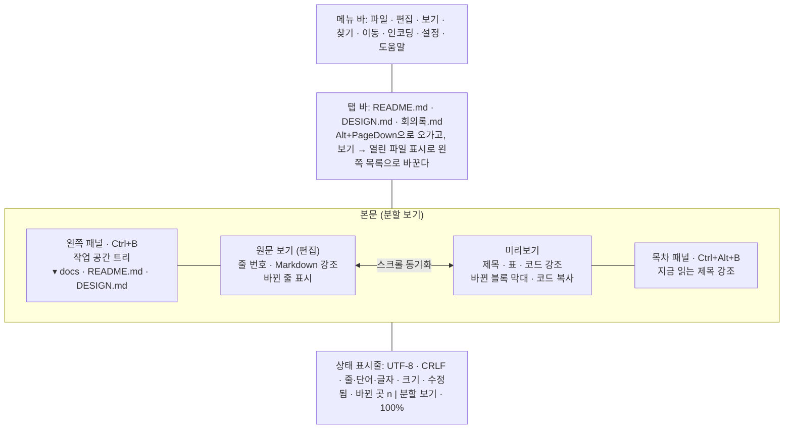
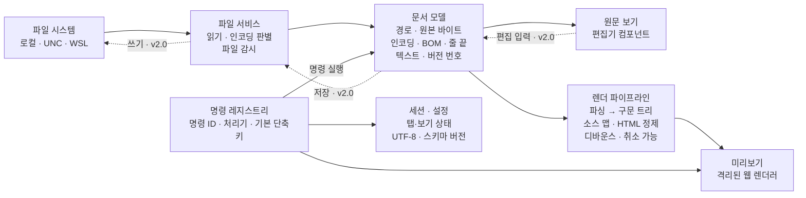

# 마크다운 뷰어 소프트웨어 요구사항 명세서 (SRS)

2026-10-31 · 버전 0.8 (보고서 루프)

## 1. 개요

이 문서는 Markdown 파일을 빠르게 열어 읽는 뷰어 v1.0~v2.1의 요구사항을 정의한다. 뷰어는 설치 없이 브라우저에서 도는 HTML 파일 하나이고, 명령줄과 Claude Code에서 문서를 바로 띄우는 로컬 실행기와, 탐색기에서 문서를 바로 여는 Windows 앱(v1.1)이 함께 있다. 편집 기능은 v1.0에서 빼고 구조 요구사항(6장)만 지켜 오다가, v2.0에서 원문·분할 보기 편집과 저장(3.12)으로 넣었다.

### 1.1 목적

기획·구현·검증의 단일 기준 문서다. 요구사항마다 ID를 붙여 구현 항목과 테스트를 추적한다.

### 1.2 제품 범위

- 포함: 뷰어 HTML 하나로 여러 .md 파일을 탭으로 열고(파일 선택·끌어다 놓기), 미리보기와 원문을 오가며 읽고, 찾고, 목차로 이동한다.
- 포함: 로컬 실행기. 명령줄(`mdview <파일>`)이나 Claude Code 스킬로 문서를 브라우저에 띄운다. 이렇게 연 문서는 상대 경로 이미지·링크와 외부 변경 반영이 모두 동작한다.
- 포함: 폴더 단위 탐색, 외부 변경 자동 반영, 세션 복원, 인쇄. HTML·PDF 내보내기는 권장(v1.1)이다.
- 포함(v1.1): Windows 앱(MDViewer.exe). 설치 없이 EXE 파일 하나로 뷰어를 자기 창에 띄우고, 탐색기에서 .md를 더블클릭해 바로 연다.
- 포함(v2.0): 원문·분할 보기에서 문서를 고치고 원래 인코딩·줄 끝 그대로 저장한다. 다른 이름으로 저장, 새 문서, 찾아 바꾸기, 자동 저장, 닫기 전 확인, 외부 변경 충돌 처리를 함께 둔다.
- 제외: 설치 프로그램이나 관리자 권한이 필요한 설치(v0.1의 setup.exe), 플러그인, 클라우드 동기화, 협업.

### 1.3 용어

| 용어 | 뜻 |
| --- | --- |
| 뷰어 | 브라우저에서 도는 MD Viewer 화면. HTML 파일 하나(`viewer.html`)로 배포한다 |
| 독립 모드 | 뷰어 HTML을 직접 열어(file://) 쓰는 방식. 문서는 파일 선택이나 끌어다 놓기로 연다 |
| 실행기 | 이 컴퓨터 안에서만 접속을 받는 작은 웹 서버와 명령줄 도구(`mdview`). 문서를 읽어 뷰어에 넘기고 브라우저를 연다 |
| 실행기 모드 | 실행기가 띄운 뷰어로 쓰는 방식 |
| Windows 앱 | 뷰어를 자기 창(WebView2)에 띄우는 Windows 실행 파일 MDViewer.exe(v1.1). 설치 없이 EXE 하나로 돌고, 파일은 앱이 OS 경로로 직접 읽는다 |
| 스킬 | Claude Code가 요청에 맞춰 불러 쓰는 작업 지침 묶음. 여기서는 실행기를 부르는 `mdview` 스킬 |
| 미리보기 | Markdown을 HTML로 렌더링해 보여주는 화면 |
| 원문 보기 | 파일 텍스트를 줄 번호·구문 강조와 함께 보여주고 고치는 화면(v2.0부터 편집) |
| 분할 보기 | 원문 보기와 미리보기를 좌우로 나란히 보여주는 화면 |
| GFM | GitHub Flavored Markdown. CommonMark에 표·작업 목록·취소선·자동 링크를 더한 규격 |
| 작업 공간 | 왼쪽 패널에 트리로 연 폴더. Notepad++의 "작업 공간으로서의 폴더"에 해당 |
| 세션 | 마지막 상태의 열린 탭, 탭별 보기 모드와 스크롤 위치 묶음 |
| 수정됨 | 마지막으로 읽거나 저장한 뒤 고쳐서, 화면의 내용이 파일과 다른 문서 상태 |
| 새 문서 | 아직 파일이 없는 문서(제목 없음 n). 처음 저장할 때 위치를 정한다 |
| 우선순위 | 필수 = 출시 조건(따로 적지 않으면 v1.0, FR-DESK는 v1.1, FR-EDIT는 v2.0), 권장 = v1.x, 선택 = 여유 있을 때 |

### 1.4 참고

- ISO/IEC/IEEE 29148:2018 요구사항 공학 — 이 SRS의 장 구성 참고
- [CommonMark Spec](https://spec.commonmark.org/0.31.2/), [GitHub Flavored Markdown Spec](https://github.github.com/gfm/) — 렌더링 규격
- [File System Access](https://wicg.github.io/file-system-access/), HTML Drag and Drop API — 독립 모드의 파일·폴더 열기
- Claude Code 스킬(Agent Skills) 문서 — 스킬 형식과 설치 위치
- Notepad++ — 탭, 세션, 인코딩, 찾기 동작의 기준 사례

### 1.5 변경 이력

| 버전 | 날짜 | 내용 |
| --- | --- | --- |
| 0.8 | 2026-10-31 | Claude Code 보고서 루프(v2.1.0, 사용자 use case 검토). FR-LAUNCH-06·FR-WATCH-05·FR-INFO-04 신설, FR-WATCH-04·FR-NAV-05·FR-REN-09를 v2.1에 넣음, FR-FILE-04·FR-EXP-01·FR-FIND-01·FR-NAV-03·FR-LAUNCH-02 보강. 3장 머리말, 4.1·4.2, 7·8·9장 개정. SRS·SDD를 Claude Docs에서 저장소 docs/로 옮김 |
| 0.7 | 2026-10-30 | 편집기를 넣음(v2.0.0, 사용자 요청). 3.12 FR-EDIT-01~10 신설(원문·분할 보기 편집, 저장·다른 이름으로 저장, 새 문서, 찾아 바꾸기, 닫기 확인, 외부 변경 충돌, 자동 저장), NFR-ENC-05·NFR-SEC-05·NFR-PERF-08 신설, NFR-SEC-02 개정. FR-FILE-04·FR-WATCH-01·03·FR-INFO-02·FR-SESS-02, 1장·1.2·1.3·2.1, 4장(4.1·4.2·4.3), 6장 머리말, 7·8·9장 개정 |
| 0.6 | 2026-10-30 | 화면 배치를 바꿈(v1.3.0, 사용자 요청). 목차는 문서 오른쪽 패널, 왼쪽 패널은 작업 공간이고, 열린 파일을 목록으로 보게 하면 그 위 칸에 목록을 둔다. FR-FILE-05·FR-NAV-01·FR-NAV-02·FR-SESS-02, 1.3, 4장(머리말·4.1 목업·4.2), 7·9장 개정. 릴리스 zip 하나에 EXE까지 담음 |
| 0.5 | 2026-10-29 | FR-REN-07(Mermaid)을 v1.2.0에 구현하며 요구사항을 구체화함. NFR-SEC-01에 다이어그램 SVG 예외, NFR-SEC-04에 격리된 무대, NFR-PERF-07 신설, NFR-PORT-03 상한 상향(뷰어 HTML 3.5 MiB, 스킬 묶음 4 MiB, EXE 5 MiB). 7·9장 개정 |
| 0.4 | 2026-10-28 | FR-REN-08에 front matter의 범위(첫 줄 --- 블록)와 목차 제외를 적음. 7장에 v1.1.1 출시, 9장에 기본 글꼴(맑은 고딕) 결정을 더함 |
| 0.3 | 2026-10-28 | v1.1 배포 형태로 Windows 앱(MDViewer.exe)을 더함. FR-DESK 신설(3.11), 2.1 표·운영 환경·제약·가정, FR-FILE-01·04·07, 4.3, NFR-PERF-01·04, NFR-SEC-02, NFR-ENC-04, NFR-REL-02~03, NFR-PORT-01·03, 7·8·9장 개정 |
| 0.2 | 2026-10-08 | 배포 형태를 설치형 데스크톱 앱에서 HTML 뷰어와 로컬 실행기로 바꿈. 독립 모드·실행기 모드 정의, FR-LAUNCH 신설, 브라우저 예약 단축키를 피해 4.2 개정, 창·설치 관련 요구사항 정리 |
| 0.1 | 2026-10-04 | 초안(Windows 데스크톱 앱) |

## 2. 전체 설명

서버·계정 없이 개인 PC에서 도는 뷰어다. 브라우저만 있으면 설치 없이 열리고, 1차 대상은 Windows 10/11의 Edge·Chrome이고, Windows에서는 EXE 하나로 된 앱으로도 쓴다. Notepad++처럼 가볍게 뜨고, 탭으로 여러 파일을 다루고, 키보드만으로 쓸 수 있어야 한다.

### 2.1 제품 관점

- 뷰어는 HTML·CSS·JavaScript를 모두 담은 파일 하나다. 네트워크 없이 모든 기능이 동작한다.
- 같은 뷰어가 세 방식으로 돈다(아래 표). 세 방식은 화면과 기능이 같고, 문서를 읽고 쓰는 길만 다르다.
- 원문 보기는 편집기 컴포넌트를 쓴다. v1.x는 읽기 전용으로 썼고, v2.0부터 원문·분할 보기에서 고친다(3.12). 미리보기는 읽기 전용이다.

| 방식 | 여는 법 | 문서를 읽고 쓰는 길 | 제한 |
| --- | --- | --- | --- |
| 독립 모드 | `viewer.html`을 브라우저로 연다 | 파일 선택, 끌어다 놓기. Edge·Chrome은 파일·폴더 핸들로 읽고 쓴다(쓰기 권한은 처음 저장할 때 묻는다). 핸들이 없는 문서는 다른 이름으로 저장한다 | 폴더를 열지 않으면 상대 경로 이미지·링크를 따라가지 못한다. 외부 변경 반영·세션 복원은 Edge·Chrome만 된다. file:// 페이지의 저장소는 같은 브라우저의 다른 로컬 HTML과 함께 쓰이므로, 기억한 파일·폴더 접근 권한이 그 페이지에도 열릴 수 있다(설정에서 끈다) |
| 실행기 모드 | `mdview <파일>` 또는 Claude Code 스킬 | 실행기가 로컬 파일을 읽어 넘기고, 허용 폴더 안에만 쓴다 | Node.js가 있어야 한다 |
| Windows 앱(v1.1) | MDViewer.exe를 실행하거나, 탐색기 연결 프로그램에 등록한 뒤 .md를 더블클릭한다 | 앱이 OS 경로로 파일을 직접 읽어 넘긴다. 대화상자·끌어다 놓기도 OS 경로를 준다. 연 파일과 저장 대화상자로 고른 파일에만 쓴다 | Windows 10/11 x64만. WebView2 런타임과 .NET Framework 4.8(둘 다 Windows 기본 포함)이 있어야 한다 |

### 2.2 사용자

- 주 사용자: README, 설계 문서, AI가 만든 .md 보고서를 자주 읽는 개발자·기술 문서 작성자.
- Claude Code로 문서를 만들고 바로 읽어 보는 사용자. 대화 중에 "이 문서 열어줘"로 뷰어를 띄운다.
- 키보드 단축키에 익숙하고, 한 번에 여러 문서를 오가며 읽는다.
- 한글 문서와 한글 파일명·폴더명 비중이 높다.

### 2.3 운영 환경

- 브라우저 1차: Microsoft Edge·Google Chrome 최근 2개 메이저 버전(Windows 10 22H2·11 x64). 2차: Firefox·Safari 최신판(기본 기능).
- 실행기: Node.js 18 이상. Windows 10/11, WSL2, macOS, Linux.
- Windows 앱: Windows 10 22H2·11 x64. Microsoft Edge WebView2 런타임과 .NET Framework 4.8(둘 다 Windows 기본 포함).
- 화면 1366×768 이상, 배율 100~200%.
- 파일 위치: 로컬 디스크, 네트워크 공유(UNC), WSL 파일 시스템(\\\\wsl.localhost\\…). 실행기 모드는 실행기가 읽을 수 있는 경로를 모두 다룬다.

### 2.4 설계·구현 제약

- 렌더링에 쓰는 라이브러리(코드 강조, 편집기 등)는 모두 뷰어 HTML 안에 넣는다. CDN에 기대지 않는다.
- 설치하지 않는다. 뷰어는 파일 하나로 열리고, 실행기는 Node.js 표준 라이브러리만 써서 따로 설치할 패키지가 없다. Windows 앱은 EXE 파일 하나이고, 필요한 DLL은 EXE 안에 넣어 처음 실행 때 사용자 폴더에 푼다. 관리자 권한을 요구하지 않는다.
- 실행기는 루프백 주소(127.0.0.1)에서만 접속을 받는다.
- 기술 스택은 9장의 결정을 따른다.
- Python을 쓰는 경우 파일·콘솔·로그 입출력에 인코딩을 항상 명시한다. Windows 기본 코드페이지(CP949)에 기대면 안 된다.

### 2.5 가정과 의존성

- 대부분 문서는 1 MB 이하의 UTF-8 파일이다.
- 한 사람이 자기 PC에서 쓴다. 동시 편집·공유는 고려하지 않는다.
- 브라우저는 이미 설치되어 있다. 독립 모드의 폴더 열기·외부 변경 반영·세션 복원은 File System Access API(Edge·Chrome)에 기대며, file://로 연 페이지에서도 쓸 수 있음을 확인했다(Edge 154).
- 실행기 모드는 Node.js 18 이상에 기댄다. Claude Code 스킬은 사용자 스킬 폴더(`~/.claude/skills`)에 둔다.
- WSL2에서 띄운 실행기는 Windows 브라우저가 localhost로 접속한다(기본 localhost 포워딩, 확인함).
- Windows 앱은 Windows 10/11에 기본으로 있는 WebView2 런타임(Edge 기반)과 .NET Framework 4.8에 기댄다. 런타임이 없으면 내려받기 페이지를 안내한다.

## 3. 기능 요구사항

기능 요구사항은 71개다. 필수 32개가 v1.0 출시 조건이었고, Windows 앱 요구사항 5개(3.11, 필수 4·권장 1)를 v1.1에 넣었다. 권장 18개는 v1.1, 선택 3개는 여유 있을 때 넣는다(7장). 편집·저장 요구사항 10개(3.12, 모두 필수)는 v2.0에 넣었다. Claude Code로 만든 보고서를 읽고 고치는 흐름을 위한 요구사항 3개(FR-LAUNCH-06, FR-WATCH-05, FR-INFO-04, 모두 권장)는 v2.1에 더했다. 세 방식(독립 모드·실행기 모드·Windows 앱)에서 다르게 동작하는 요구사항은 그 차이를 항목 안에 적는다.

### 3.1 파일 열기와 탭 (FR-FILE)

| ID | 요구사항 | 우선순위 |
| --- | --- | --- |
| FR-FILE-01 | 파일 선택(메뉴·Ctrl+O), 끌어다 놓기, 실행기(명령줄·Claude Code 스킬), Windows 앱(시작 인자·탐색기 연결)으로 파일을 연다. | 필수 |
| FR-FILE-02 | 여러 파일을 한 번에 열고, 파일마다 탭 하나로 연다. | 필수 |
| FR-FILE-03 | 이미 열린 파일을 다시 열면 새 탭 대신 그 탭으로 이동한다. | 필수 |
| FR-FILE-04 | 실행기가 이미 떠 있으면 새로 띄우지 않고 그 실행기로 연다. 같은 실행기의 뷰어 탭은 하나만 남기고, 새로 연 탭이 이전 탭의 문서를 넘겨받는다. v0.1의 단일 인스턴스를 대신한다. Windows 앱은 두 번째 실행이 위치를 첫 창에 넘긴다(FR-DESK-02). 고친 문서가 있는 이전 뷰어 탭은 물러나지 않는다(FR-EDIT-08). 이미 열린 문서를 실행기로 다시 열면 읽던 위치와 보기 모드를 이어 간다(위치를 붙여 열면 그 위치, FR-LAUNCH-06). | 필수 |
| FR-FILE-05 | 탭을 끌어 순서를 바꾸고, 닫기·다른 탭 모두 닫기·닫은 탭 다시 열기를 제공한다. 열린 파일은 위쪽 탭 줄(기본)이나 Notepad++의 문서 목록처럼 왼쪽 패널 위 칸의 목록으로 보이고, 사용자가 보기 메뉴에서 고른다. 목록에서도 누르기·끌기·가운데 클릭으로 닫기가 같다. | 필수 |
| FR-FILE-06 | 최근 파일 20개와 최근 폴더 10개를 기억하고 메뉴에서 연다. 독립 모드는 브라우저가 접근 권한을 다시 물을 수 있다. | 필수 |
| FR-FILE-07 | UNC 경로와 WSL 경로의 파일을 연다(실행기 모드, Windows 앱). | 권장 |
| FR-FILE-08 | .txt 등 Markdown이 아닌 텍스트 파일은 원문 보기로 연다. | 권장 |

### 3.2 렌더링 (FR-REN)

| ID | 요구사항 | 우선순위 |
| --- | --- | --- |
| FR-REN-01 | CommonMark와 GFM(표, 작업 목록, 취소선, 자동 링크)을 규격대로 렌더링한다. | 필수 |
| FR-REN-02 | 코드 블록을 지정 언어에 맞춰 구문 강조한다. 주요 언어 20종 이상. | 필수 |
| FR-REN-03 | 상대 경로 이미지를 문서 파일 위치 기준으로 표시한다. 독립 모드에서 문서 폴더에 접근할 수 없으면 폴더를 열라는 안내를 보여준다. | 필수 |
| FR-REN-04 | 렌더링에 실패한 블록은 원문과 오류 메시지로 대신 보여주고, 나머지는 정상 표시한다. | 필수 |
| FR-REN-05 | 각주와 제목 앵커(제목 옆 링크 복사)를 지원한다. | 권장 |
| FR-REN-06 | 수식(인라인 `$…$`, 블록 `$$…$$`)을 렌더링한다. | 권장 |
| FR-REN-07 | `mermaid` 코드 블록을 다이어그램으로 그린다(Mermaid 12.2, ELK 레이아웃 포함). 그리기 전과 실패했을 때는 원문 코드를 보여주고, 다이어그램 안 글자도 찾기·복사가 된다. 테마를 바꾸면 그 색으로 다시 그린다. 다이어그램 안의 링크·콜백·이미지는 따르거나 불러오지 않는다(NFR-SEC-01·04). | 권장 |
| FR-REN-08 | YAML front matter를 본문에서 빼고 접을 수 있는 메타데이터 상자로 보여준다. 문서 첫 줄의 `---`부터 다음 `---`·`...` 줄까지를 front matter로 보고, 목차에는 넣지 않는다. | 권장 |
| FR-REN-09 | 코드 블록마다 복사 버튼과 언어 이름을 단다. 인쇄에는 나오지 않는다. | 선택 |

### 3.3 보기 모드 (FR-VIEW)

| ID | 요구사항 | 우선순위 |
| --- | --- | --- |
| FR-VIEW-01 | 탭마다 미리보기, 원문 보기, 분할 보기를 전환한다. | 필수 |
| FR-VIEW-02 | 원문 보기는 줄 번호, Markdown 구문 강조, 자동 줄 바꿈 켜고 끄기를 제공한다. | 필수 |
| FR-VIEW-03 | Ctrl+휠, Ctrl+=/-, Ctrl+0으로 50~300% 확대·축소한다. | 필수 |
| FR-VIEW-04 | 라이트·다크 테마와 "시스템 설정 따르기"를 제공한다. | 필수 |
| FR-VIEW-05 | 분할 보기에서 한쪽을 스크롤하면 다른 쪽이 같은 위치로 따라간다. | 권장 |
| FR-VIEW-06 | 미리보기 본문 폭(좁게·보통·전체)과 본문·코드 글꼴을 바꾼다. | 권장 |
| FR-VIEW-07 | 전체 화면(F11)과 탭·패널을 숨기는 읽기 모드를 제공한다. | 선택 |

### 3.4 탐색 (FR-NAV)

| ID | 요구사항 | 우선순위 |
| --- | --- | --- |
| FR-NAV-01 | 제목(H1~H6)으로 목차 패널을 만들고, 클릭하면 그 위치로 간다. 지금 읽는 제목을 강조한다. 목차 패널은 문서 오른쪽에 두고 따로 열고 닫는다(Ctrl+Alt+B). | 필수 |
| FR-NAV-02 | 폴더를 열면(폴더 선택·끌어다 놓기·실행기) 왼쪽 패널에 트리로 보여주고, 파일을 클릭하면 탭으로 연다(작업 공간). 열린 파일을 목록으로 볼 때는 목록 아래 칸에 둔다. | 필수 |
| FR-NAV-03 | 문서 안 링크를 따라간다. 다른 .md는 뷰어의 새 탭, #앵커는 해당 제목, http(s)는 브라우저의 새 탭으로 연다. 독립 모드는 열린 폴더 안의 문서만 따라간다. 다른 문서 링크를 가운데 클릭하면 뷰어의 새 탭으로 열고 지금 탭에 머문다. | 필수 |
| FR-NAV-04 | 링크 이동 이력을 뒤로·앞으로(Alt+←/→) 오간다. | 권장 |
| FR-NAV-05 | 줄 번호로 이동한다(Ctrl+G). 미리보기에서는 그 줄을 담은 블록으로 가고, 원문 보기에서는 커서도 그 줄로 옮긴다. | 권장 |
| FR-NAV-06 | 빠른 열기(Ctrl+Shift+O)로 작업 공간 안 파일 이름을 퍼지 검색해 연다. | 선택 |

### 3.5 찾기 (FR-FIND)

| ID | 요구사항 | 우선순위 |
| --- | --- | --- |
| FR-FIND-01 | 현재 문서에서 찾고(Ctrl+F), 다음·이전(F3/Shift+F3)으로 이동하며, 일치 개수를 보여준다. 한글 등 입력기로 글자를 조합하는 중에 누른 Enter는 조합만 끝내고 다음 일치로 넘어가지 않는다. | 필수 |
| FR-FIND-02 | 대소문자 구분, 단어 단위, 정규식 옵션을 제공한다. | 필수 |
| FR-FIND-03 | 미리보기와 원문 보기 모두에서 찾고, 일치 부분을 강조한다. | 필수 |
| FR-FIND-04 | 작업 공간 전체 파일에서 찾고(Ctrl+Shift+F), 결과를 클릭하면 해당 위치를 연다. | 권장 |

### 3.6 파일 감시 (FR-WATCH)

| ID | 요구사항 | 우선순위 |
| --- | --- | --- |
| FR-WATCH-01 | 열린 파일이 밖에서 바뀌면 자동으로 다시 읽고 스크롤 위치를 유지한다. 독립 모드는 파일 핸들로 연 경우(Edge·Chrome)에만 해당한다. 고친 문서는 자동으로 다시 읽지 않는다(FR-EDIT-09). | 필수 |
| FR-WATCH-02 | 파일이 삭제·이름 변경되면 탭에 표시하고 마지막 내용을 유지한다. 독립 모드는 파일 핸들로 연 경우에만 해당한다. | 필수 |
| FR-WATCH-03 | F5로 수동 새로 고침한다. 독립 모드에서 핸들 없이 연 파일은 다시 읽지 못한다고 알린다. 고친 문서는 고친 내용을 버릴지 먼저 묻는다. | 필수 |
| FR-WATCH-04 | 작업 공간 트리가 파일 추가·삭제를 반영한다. 뷰어 창이 다시 포커스를 얻을 때와 다른 이름으로 저장한 뒤 펼친 폴더를 다시 읽고, 새로 고침(↻)은 펼친 폴더를 그대로 둔다. | 권장 |
| FR-WATCH-05 | 밖에서 바뀌어 다시 읽은 문서(자동 다시 읽기, F5, 충돌 띠의 다시 읽기)는 바뀐 곳을 표시한다. 미리보기는 바뀐 블록(목록은 항목), 원문 보기는 바뀐 줄 옆에 표시하고, 줄만 지운 자리도 표시한다. 상태 표시줄에 바뀐 곳 수를 보이고, 다음·이전 바뀐 곳으로 이동한다(Alt+F5 / Shift+Alt+F5). 표시는 문서를 고치거나 다시 읽을 때까지 남고 세션에는 남기지 않는다. | 권장 |

### 3.7 세션과 설정 (FR-SESS)

| ID | 요구사항 | 우선순위 |
| --- | --- | --- |
| FR-SESS-01 | 열린 탭, 활성 탭, 탭별 보기 모드·스크롤 위치를 저장하고 다음에 뷰어를 열 때 복원한다. 독립 모드는 접근 권한을 다시 확인한 뒤 복원한다. | 필수 |
| FR-SESS-02 | 왼쪽 패널(열림·너비·목록 높이)과 목차 패널(열림·너비), 보기 설정(테마·확대·줄 바꿈·열린 파일 표시 방식)과 자동 저장 설정(FR-EDIT-10)을 기억한다. 창 위치·크기는 브라우저가 맡는다. | 필수 |
| FR-SESS-03 | 설정을 사람이 읽고 고칠 수 있는 JSON 파일로 내보내고 가져온다. | 권장 |

### 3.8 인쇄와 내보내기 (FR-EXP)

| ID | 요구사항 | 우선순위 |
| --- | --- | --- |
| FR-EXP-01 | 미리보기 모양 그대로 인쇄한다(Ctrl+P). 화면 테마와 관계없이 밝은 색으로 인쇄하고, 긴 코드 줄은 접어 넓은 표와 함께 잘리지 않게 한다. | 필수 |
| FR-EXP-02 | 이미지를 포함한 단일 HTML 파일로 내보낸다. | 권장 |
| FR-EXP-03 | PDF로 내보낸다. | 권장 |
| FR-EXP-04 | 미리보기에서 선택한 부분을 서식 있는 텍스트로 복사한다. | 권장 |

### 3.9 문서 정보와 인코딩 (FR-INFO)

| ID | 요구사항 | 우선순위 |
| --- | --- | --- |
| FR-INFO-01 | 상태 표시줄에 인코딩, 줄 끝(CRLF/LF), 줄·단어·글자 수, 파일 크기를 보여준다. | 필수 |
| FR-INFO-02 | 인코딩을 직접 골라 다시 읽는다(Notepad++ 인코딩 메뉴와 같은 동작). 고친 문서는 고친 내용을 버릴지 먼저 묻는다. | 필수 |
| FR-INFO-03 | 파일 경로를 복사하고(독립 모드는 열린 폴더 기준 경로), 실행기 모드에서는 탐색기에서 파일 위치를 연다. | 권장 |
| FR-INFO-04 | 고른 부분의 위치를 `경로:시작줄-끝줄` 한 줄과 인용문으로 복사한다(Ctrl+Alt+C). Claude Code 대화에 붙여 넣어 고칠 곳을 가리키는 용도다. 미리보기에서 고른 부분은 그 블록의 원문 줄로 바꾸고, 고른 것이 없으면 지금 줄을 쓴다. 경로는 실행기 모드·Windows 앱은 절대 경로, 독립 모드는 열린 폴더 기준 경로다. | 권장 |

### 3.10 실행기와 Claude Code 연동 (FR-LAUNCH)

| ID | 요구사항 | 우선순위 |
| --- | --- | --- |
| FR-LAUNCH-01 | 명령줄 `mdview [파일 또는 폴더 ...]`로 기본 브라우저에 뷰어를 띄워 연다. 파일은 탭으로, 폴더는 작업 공간으로 연다. `--no-open`이면 주소만 출력한다. | 필수 |
| FR-LAUNCH-02 | Claude Code에서 "이 문서 열어줘"처럼 요청하면 스킬이 대상 파일을 찾아 실행기로 연다. 후보가 여럿이라 하나로 정할 수 없거나 없으면 되묻는다. 사용자가 여러 문서를 지정하면 모두 연다. Claude가 고친 곳을 보여 줄 때는 그 제목이나 줄 위치를 붙여 연다(FR-LAUNCH-06). | 필수 |
| FR-LAUNCH-03 | 연결된 뷰어 없이 10분이 지나면 실행기가 스스로 끝난다. | 필수 |
| FR-LAUNCH-04 | WSL에서 실행하면 Windows 기본 브라우저로 연다. | 필수 |
| FR-LAUNCH-05 | 명령 한 줄(`mdview --install-skill`)로 Claude Code 스킬을 설치한다. | 권장 |
| FR-LAUNCH-06 | `mdview 문서.md#제목`·`mdview 문서.md:줄`(`#L줄`도 같음)로 그 제목이나 줄 위치에 연다. 제목은 문서에 쓰인 글 그대로나 GitHub식 id로 준다. 그 이름의 파일이 실제로 있으면 위치로 보지 않고 그 파일을 연다. | 권장 |

### 3.11 Windows 앱 (FR-DESK)

v1.1에서 더한 배포 형태다. 화면과 나머지 기능은 뷰어와 같고, 아래는 Windows 앱에만 있는 요구사항이다.

| ID | 요구사항 | 우선순위 |
| --- | --- | --- |
| FR-DESK-01 | 설치 없이 EXE 파일 하나(`MDViewer.exe`)로 실행한다. 시작 인자, EXE 아이콘에 끌어다 놓기, 창에 끌어다 놓기, Ctrl+O(Windows 파일 대화상자)로 파일과 폴더를 연다. | 필수(v1.1) |
| FR-DESK-02 | 이미 떠 있으면 두 번째 실행은 위치를 첫 창에 넘겨 새 탭으로 열고 바로 끝난다. `--new-window`면 새 창을 띄운다. | 필수(v1.1) |
| FR-DESK-03 | 설정 메뉴나 `--register`·`--unregister`로 Markdown 확장자의 탐색기 연결 프로그램 목록과 오른쪽 클릭 메뉴("MD Viewer로 열기")에 사용자 단위로 등록·해제한다. 관리자 권한을 요구하지 않고, 기본 앱은 바꾸지 않는다(Windows가 사용자에게 고르게 한다). | 필수(v1.1) |
| FR-DESK-04 | 창 위치·크기와 세션을 기억한다. 창을 닫을 때(닫기 단추, 작업 관리자의 작업 끝내기) 마지막 상태를 저장한 뒤 닫는다. | 필수(v1.1) |
| FR-DESK-05 | 제목 표시줄을 테마에 맞추고, WebView2 런타임이 없으면 내려받기 페이지를 안내한다. | 권장 |

### 3.12 편집과 저장 (FR-EDIT)

v2.0에서 더했다. 원문·분할 보기는 늘 편집할 수 있고, 미리보기 모드는 읽기 전용이다. 세 방식의 차이는 저장하는 길(쓸 수 있는 파일과 저장 대화상자)뿐이다.

| ID | 요구사항 | 우선순위 |
| --- | --- | --- |
| FR-EDIT-01 | 원문·분할 보기에서 원문을 고친다. 실행 취소·다시 실행(Ctrl+Z, Ctrl+Y·Ctrl+Shift+Z)을 쓰고, 기록은 문서마다 따로 남는다. 목록 기호 이어 쓰기와 Tab 들여쓰기를 지원한다. 미리보기 모드와 바이너리 문서는 읽기 전용이다. | 필수(v2.0) |
| FR-EDIT-02 | 고친 문서는 탭·열린 파일 목록·창 제목에 ●를, 상태 표시줄에 "수정됨"을 보인다. 실행 취소로 저장한 내용과 같아지면 표시를 지운다. | 필수(v2.0) |
| FR-EDIT-03 | 입력이 멈추면 분할 보기의 미리보기와 목차를 다시 그린다(실시간 미리보기). 대용량 기준(5 MB)을 넘는 문서는 자동으로 다시 그리지 않는다. | 필수(v2.0) |
| FR-EDIT-04 | 저장(Ctrl+S)은 원래 인코딩·BOM·줄 끝으로 제자리에 쓴다. 원래 인코딩에 없는 글자가 있으면 UTF-8로 저장할지, 읽을 때 잘못된 바이트가 있었으면 대체 문자로 바뀌는데 저장할지 묻는다. 줄 끝이 섞인 문서는 많은 쪽으로 맞추고 알린다. 독립 모드는 파일 핸들에 쓰고(쓰기 권한은 처음 저장할 때 묻는다), 핸들이 없는 문서는 다른 이름으로 저장으로 넘긴다. 실행기는 허용 폴더 안에만, Windows 앱은 연 파일과 저장 대화상자로 고른 파일에만 쓴다. | 필수(v2.0) |
| FR-EDIT-05 | 다른 이름으로 저장(Ctrl+Shift+S) 뒤에는 탭이 새 파일을 가리킨다. 독립 모드는 브라우저 저장 대화상자(Firefox·Safari는 내려받기), 실행기는 경로 입력 대화상자(허용 폴더 안), Windows 앱은 Windows 저장 대화상자를 쓴다. 고른 파일이 이미 있으면 덮어쓸지 묻는다. | 필수(v2.0) |
| FR-EDIT-06 | 새 문서(Alt+Shift+N)는 "제목 없음 n" 탭을 원문 보기로 연다. 처음 저장할 때 다른 이름으로 저장하고, 그전에는 세션·최근 목록·닫은 탭 목록에 남기지 않는다. | 필수(v2.0) |
| FR-EDIT-07 | 찾아 바꾸기(Ctrl+H)는 찾기 바에 바꾸기 칸과 바꾸기·모두 바꾸기를 둔다. 찾기 옵션(대소문자·단어·정규식, $1 참조)을 그대로 쓴다. 원문·분할 보기에서만 쓰고, 모두 바꾸기는 실행 취소 한 번으로 되돌린다. | 필수(v2.0) |
| FR-EDIT-08 | 저장하지 않은 문서를 닫으면(탭 닫기, 다른 탭 모두 닫기, 폴더 기준 다시 열기, Windows 앱 창 닫기와 Windows 종료) 저장·저장 안 함·취소를 묻는다. 브라우저 탭을 닫거나 새로 고치면 브라우저 기본 확인 창이 뜬다. 고친 문서가 있는 실행기 뷰어 탭은 새 뷰어 탭에 문서를 넘기고 물러나지 않는다. | 필수(v2.0) |
| FR-EDIT-09 | 고친 문서가 밖에서 바뀌면 자동으로 다시 읽지 않고 알림 띠(다시 읽기 / 내 것 유지)를 뛄운다. 저장할 때 디스크 파일이 읽은 뒤 바뀌었으면 덮어쓸지 묻는다. 자기 저장이 일으킨 변경 알림은 무시한다. 고치지 않은 문서는 지금처럼 다시 읽되 커서·스크롤·실행 취소 기록을 유지한다. | 필수(v2.0) |
| FR-EDIT-10 | 자동 저장(설정, 기본 끔)을 켜면 입력이 멈추고 1초 뒤, 그리고 다른 탭으로 옮길 때 저장한다. 제자리에 쓸 수 있는 문서만 대상이고, 충돌이 나거나 쓰기 권한이 없으면 멈추고 알린다. | 필수(v2.0) |

## 4. 외부 인터페이스 요구사항

화면은 여섯 영역(메뉴·탭 바·왼쪽 패널·본문·목차 패널·상태 표시줄)으로 나뉘고, 주요 기능은 모두 단축키를 갖는다. 뷰어는 브라우저 탭 하나나 Windows 앱(MDViewer.exe)의 창 하나를 다 쓰고, 실행기 명령 이름은 `mdview`다.

### 4.1 화면 구성

*화면 구성: 목차는 오른쪽, 작업 공간은 왼쪽 패널에 두고 가운데서 원문과 미리보기를 나란히 본다.*

위에서부터 메뉴 바, 탭 바(FR-FILE-05), 본문, 상태 표시줄(FR-INFO-01)이다. 본문 왼쪽 패널은 작업 공간(FR-NAV-02), 오른쪽 패널은 목차(FR-NAV-01)다. 열린 파일을 목록으로 보게 하면 탭 바가 왼쪽 패널 위 칸의 목록이 되고 작업 공간은 그 아래 칸으로 간다. 본문은 탭마다 미리보기·원문·분할 보기 중 하나다(FR-VIEW-01). 고친 문서는 탭·목록·창 제목에 ●, 상태 표시줄에 "수정됨"을 보이고, 고친 채 밖에서 바뀌면 본문 위에 알림 띠를 띄운다(FR-EDIT-02·09). 밖에서 바뀌어 다시 읽은 문서는 바뀐 블록·줄에 표시를 하고 상태 표시줄에 바뀐 곳 수를 보인다(FR-WATCH-05). 메뉴 바에는 편집(E) 메뉴가 있다.

### 4.2 키보드 단축키

| 동작 | 단축키 | 관련 ID |
| --- | --- | --- |
| 파일 열기 | Ctrl+O | FR-FILE-01 |
| 새 문서 | Alt+Shift+N | FR-EDIT-06 |
| 저장 | Ctrl+S | FR-EDIT-04 |
| 다른 이름으로 저장 | Ctrl+Shift+S | FR-EDIT-05 |
| 실행 취소·다시 실행 | Ctrl+Z / Ctrl+Y 또는 Ctrl+Shift+Z | FR-EDIT-01 |
| 탭 닫기 | Alt+W | FR-FILE-05 |
| 닫은 탭 다시 열기 | Alt+Shift+T | FR-FILE-05 |
| 다음·이전 탭 | Alt+PageDown / Alt+PageUp | FR-FILE-05 |
| 미리보기·원문·분할 보기 | Ctrl+1 / Ctrl+2 / Ctrl+3 | FR-VIEW-01 |
| 자동 줄 바꿈 | Alt+Z | FR-VIEW-02 |
| 확대·축소·원래대로 | Ctrl+= / Ctrl+- / Ctrl+0 | FR-VIEW-03 |
| 전체 화면 | F11(브라우저 기능) | FR-VIEW-07 |
| 왼쪽 패널 열기·닫기 | Ctrl+B | FR-NAV-02, FR-FILE-05 |
| 목차 패널 열기·닫기 | Ctrl+Alt+B | FR-NAV-01 |
| 뒤로·앞으로 | Alt+← / Alt+→ | FR-NAV-04 |
| 줄로 이동 | Ctrl+G | FR-NAV-05 |
| 위치 복사 | Ctrl+Alt+C | FR-INFO-04 |
| 다음·이전 바뀐 곳 | Alt+F5 / Shift+Alt+F5 | FR-WATCH-05 |
| 빠른 열기 | Ctrl+Shift+O | FR-NAV-06 |
| 찾기 | Ctrl+F | FR-FIND-01 |
| 다음·이전 찾기 | F3 / Shift+F3 | FR-FIND-01 |
| 찾아 바꾸기 | Ctrl+H | FR-EDIT-07 |
| 폴더에서 찾기 | Ctrl+Shift+F | FR-FIND-04 |
| 새로 고침 | F5 | FR-WATCH-03 |
| 인쇄 | Ctrl+P | FR-EXP-01 |
| 단축키 목록 | F1 | NFR-USE-01 |

단축키는 명령 레지스트리(ARCH-05)에 등록해, v1.1부터 사용자가 바꿀 수 있게 한다. 브라우저가 페이지에 넘기지 않는 단축키(Ctrl+W, Ctrl+T, Ctrl+N, Ctrl+Tab, Ctrl+Shift+T, Ctrl+PageUp/PageDown 등)는 쓰지 않는다. 나머지 단축키는 뷰어가 먼저 받아 브라우저 기본 동작(찾기·인쇄·새로 고침 등)을 막는다. 아직 없는 기능의 단축키(Alt+←/→, Ctrl+Shift+O, Ctrl+Shift+F)도 지금 잡아 두어 뒤로 가기 같은 브라우저 동작으로 빠지지 않게 하고, 누르면 그 기능 이름과 함께 아직 없다고 알린다.

편집 단축키(v2.0): Ctrl+N은 브라우저가 넘기지 않고 Alt+N은 인코딩 메뉴라서 새 문서는 Alt+Shift+N이다. Ctrl+S·Ctrl+Shift+S·Ctrl+H는 뷰어가 먼저 받아 브라우저 기본 동작(페이지 저장·캐표·기록)을 막는다. 실행 취소·다시 실행은 편집기가 받고, 메뉴에는 키를 표시만 한다(찾기 칸 같은 입력 칸의 실행 취소를 빼앗지 않도록).

### 4.3 브라우저·실행기·Claude Code·Windows 연동

- 독립 모드: `viewer.html`을 더블클릭하거나 브라우저로 끌어다 놓아 연다. 문서는 파일 선택(Ctrl+O)이나 끌어다 놓기로 연다. 파일 여러 개는 각각 탭으로, 폴더는 작업 공간으로 연다. 저장은 그 파일 핸들에 쓰고, 핸들이 없으면 다른 이름으로 저장(Firefox·Safari는 내려받기)한다.
- 실행기: `mdview [--root 폴더] [--no-open] [파일 또는 폴더 ...]`. 실행기는 127.0.0.1에서만 접속을 받고, 뷰어 페이지를 포함해 실행기가 만든 토큰이 있는 요청에만 응답한다. 명령은 node mdview.mjs로 부르고, --install-skill이 mdview 명령을 사용자 명령 폴더에 만든다. 문서·이미지는 허용된 폴더(연 파일의 저장소 루트나 폴더, 또는 `--root`) 안에서만 읽고, 문서는 그 안의 문서 확장자 파일에만 쓴다(FR-EDIT-04).
- Claude Code: 스킬 폴더(`~/.claude/skills/mdview`)에 SKILL.md·실행기·뷰어를 둔다. 스킬은 대상 문서의 경로를 정해 실행기를 부르고, 열린 주소를 대화에 알려 준다.
- Windows 앱: `MDViewer.exe [--new-window] [--register | --unregister] [파일 또는 폴더 ...]`. 화면은 앱 안의 가상 주소(`https://app.mdview`)에서만 돌고 다른 주소로 이동하지 않는다. 문서·그림은 앱이 OS 경로로 읽어 넘기고, 그 밖의 OS 일(대화상자·감시·저장·탐색기·연결 프로그램 등록)은 허용 목록에 있는 메시지로만 받는다. 문서는 앱이 읽어 준 파일과 저장 대화상자로 고른 파일에만 쓴다. 외부 링크는 기본 브라우저에 넘긴다.
- 외부 링크(http, https, mailto)는 브라우저 새 탭이나 기본 메일 프로그램에 넘긴다. 그 밖의 스킴(file:, javascript: 등)과 실행 파일 경로는 열지 않는다.
- 클립보드: 원문 보기에서 복사하면 일반 텍스트, 미리보기에서 복사하면 HTML과 일반 텍스트를 함께 넣는다.
- v0.1의 설치 프로그램은 뺀다. 파일 연결·탐색기 오른쪽 클릭 메뉴는 Windows 앱의 사용자 단위 등록(FR-DESK-03)으로 대신한다.

## 5. 비기능 요구사항

"Notepad++ 수준"의 체감은 바로 뜨고, 한글 인코딩을 알아서 맞추고, 어떤 파일에도 멈추지 않는 것이다. 성능 수치는 기준 PC(4코어 CPU, 16 GB RAM, SSD, Windows 11, Edge 최신판)에서 10회 측정한 중앙값으로 판정한다.

| ID | 요구사항 | 합격 기준 |
| --- | --- | --- |
| NFR-PERF-01 | 시작: 독립 모드는 뷰어 페이지를 열어 빈 화면이 뜨기까지, 실행기 모드는 실행기 명령부터, Windows 앱은 앱 실행부터 첫 탭 렌더링까지(브라우저를 띄우는 시간 제외) | 독립 1초 이하, 실행기·Windows 앱 2초 이하 |
| NFR-PERF-02 | 1 MB Markdown 파일 미리보기 렌더링 | 1초 이하 |
| NFR-PERF-03 | 10 MB 파일 열기. 5 MB를 넘는 파일은 원문 보기로 열고 미리보기는 사용자가 켠다 | 원문 표시 2초 이하, UI 멈춤 없음 |
| NFR-PERF-04 | 밖에서 저장을 마친 때부터 화면 반영까지(1 MB 이하 문서) | 실행기 모드와 Windows 앱의 로컬 디스크 0.5초 이하, 폴링 경로(WSL의 /mnt, 네트워크 공유)와 독립 모드 1.5초 이하 |
| NFR-PERF-05 | 1 MB 문서에서 찾기 결과 강조 | 0.3초 이하 |
| NFR-PERF-06 | 일반 문서 탭 20개를 연 뷰어 페이지의 메모리(JS 힙 사용량) | 200 MB 이하 |
| NFR-PERF-07 | 뷰어 페이지에서 처음 Mermaid 다이어그램이 나오는 문서를 열어 첫 다이어그램이 보이기까지(라이브러리 풀기·실행 포함) | 1.5초 이하 |
| NFR-PERF-08 | 편집 반응: 분할 보기에서 입력을 멈춘 때부터 미리보기 반영까지, 그리고 원문 보기에서 키 입력 하나가 화면에 반영되기까지 | 미리보기 100 KB 문서 0.5초 이하, 1 MB 문서 2초 이하. 키 입력 50 ms 이하(1 MB 문서) |
| NFR-ENC-01 | 인코딩 자동 판별. BOM → UTF-8 유효성 → CP949 순서로 UTF-8(BOM 유무), UTF-16 LE/BE, CP949(EUC-KR)를 가린다. UTF-16은 BOM이 있을 때만 자동 판별한다 | 인코딩 샘플 셋 100% 판별 |
| NFR-ENC-02 | 잘못된 바이트가 있어도 대체 문자(�)로 표시하고 상태 표시줄에 경고한다 | 크래시 0건 |
| NFR-ENC-03 | 원본 인코딩, BOM 유무, 줄 끝 방식을 문서 모델에 보존한다(ARCH-06) | 모델 값이 원본과 일치 |
| NFR-ENC-04 | 뷰어의 설정·세션, 실행기의 상태·로그, Windows 앱의 설정·세션·로그 파일은 항상 UTF-8로 읽고 쓴다. 한글 경로와 파일명을 지원한다 | 한글 경로 테스트 통과 |
| NFR-ENC-05 | 저장은 문서 모델의 인코딩·BOM·줄 끝으로 쓴다(ARCH-06). 열고 고치지 않은 채 저장하면 파일이 바이트 단위로 같다. 줄 끝이 섞인 문서는 많은 쪽으로 맞춘다 | UTF-8(BOM 유무), UTF-16 LE/BE, CP949, CRLF·LF 샘플 왕복 바이트 일치 |
| NFR-SEC-01 | 문서 안 `<script>`, 이벤트 처리기 속성, javascript: URL, iframe을 실행·표시하지 않는다. 그 밖의 HTML은 허용 목록으로 정제한다. 미리보기에는 style 속성·요소를 두지 않는다. 예외는 Mermaid 다이어그램 SVG뿐이며, 그 CSS는 따로 정제해 그 다이어그램 안만 꾸미고 상자 밖(앱 화면)을 덮지 못한다 | XSS 페이로드 문서(공격용 Mermaid 다이어그램 포함)에서 실행 0건 |
| NFR-SEC-02 | 문서 내용은 콘텐츠 보안 정책(CSP)과 격리된 DOM 안에서만 그린다. 실행기는 루프백 주소에서만 듣고, 토큰이 없거나 Host가 다르거나 허용 폴더 밖을 가리키는 요청을 거부하고, 쓰기 요청은 Origin까지 검사한다. Windows 앱의 화면은 앱 안의 가상 주소에서만 돌고, 앱은 그 출처가 보낸 허용 목록 메시지만 처리하며 상대 경로 읽기를 거부한다 | 격리 점검 통과(문서가 쓴 실행기·로컬 주소 이미지 제거, 뷰어 페이지·쓰기를 포함한 거부 요청 모두 403) |
| NFR-SEC-03 | 원격 이미지 불러오기를 설정에서 끌 수 있다. 기본값은 허용(9장) | 설정 전후 동작 확인 |
| NFR-SEC-04 | 사용자 동의 없이 네트워크 통신(사용 통계, 업데이트 확인)을 하지 않는다. 실행기는 바깥으로 통신하지 않는다. Mermaid 다이어그램은 바깥 요청을 모두 막은 격리 문서(iframe)에서 그려, 문서가 다이어그램 설정·라벨에 넣은 바깥 주소도 요청하지 않는다 | 원격 이미지 외 통신 0건 |
| NFR-SEC-05 | 문서 쓰기는 뷰어가 여는 문서 확장자(.md·.markdown·.mdown·.mkd·.txt 등) 파일에만 하고, 같은 폴더의 임시 파일에 쓴 뒤 바꿔 넣는다(원자적 쓰기). 실행기는 허용 폴더 안, Windows 앱은 읽어 준 파일과 저장 대화상자로 고른 파일, 독립 모드는 쓰기 권한을 받은 핸들에만 쓴다 | 쓰기 거부 점검 통과(폴더 밖·다른 확장자·연 적 없는 경로), 실패해도 원본과 임시 파일이 남지 않음 |
| NFR-REL-01 | 비정상적인 Markdown(깊은 중첩, 거대한 표, 수만 자 한 줄)에서도 크래시하거나 멈추지 않는다 | 비정상 입력 셋 통과 |
| NFR-REL-02 | 세션이 바뀔 때마다 저장해, 브라우저 탭을 갑자기 닫거나 새로 고쳐도 마지막 상태로 복원한다. Windows 앱은 창을 닫을 때도 마지막 상태를 저장한다 | 새로 고침·탭 닫기·앱 창 닫기 테스트 통과 |
| NFR-REL-03 | 실행기는 오류를 UTF-8 로그 파일에 남기고, 크기 제한을 두고 순환한다. 실행기 모드의 뷰어 오류도 이 로그로 보낸다. Windows 앱도 같은 방식으로 UTF-8 로그를 남긴다 | 로그 순환 확인 |
| NFR-USE-01 | 모든 기능을 메뉴에서 찾을 수 있고, 4.2의 기능은 키보드만으로 쓸 수 있다 | 4.2 표 전체 점검 |
| NFR-USE-02 | UI 기본 언어는 한국어다. 문자열을 코드와 분리해 영어를 추가할 수 있게 한다 | 코드 안 UI 문자열 0건 |
| NFR-USE-03 | 브라우저 확대·화면 배율 100~200%에서 글자와 아이콘이 흐리지 않다 | 100·125·150·200% 육안 점검 |
| NFR-USE-04 | 화면 낭독기가 메뉴와 미리보기 본문을 읽는다(권장) | NVDA로 점검 |
| NFR-PORT-01 | 뷰어는 Edge·Chrome 최근 2개 메이저에서 모든 기능이, Firefox·Safari 최신판에서 열기·렌더링·찾기·보기 모드가 동작한다. 실행기는 Windows 10/11, WSL2, macOS, Linux의 Node.js 18 이상에서, Windows 앱은 Windows 10/11 x64에서 동작한다 | Windows 11의 Edge·Chrome, 실행기 Windows·WSL2, Windows 앱 점검 |
| NFR-PORT-02 | OS·WSL 판별과 프로세스 실행은 실행기의 한 모듈에, 위치 형식(Windows·POSIX·가상 경로) 처리는 화면의 한 모듈에 모은다 | 코드 리뷰 |
| NFR-PORT-03 | 배포 크기 | v1.0: 뷰어 HTML 2 MB 이하, 스킬 묶음(dist/mdview 폴더 합계) 2.5 MB 이하. v1.1: Windows 앱 EXE 4 MB 이하. v1.2: Mermaid를 gzip으로 압축해 뷰어 HTML 안에 넣으며(독립 모드는 파일 하나여야 해서 별도 파일로 두지 않는다) 상한을 뷰어 HTML 3.5 MiB, 스킬 묶음 4 MiB, Windows 앱 EXE 5 MiB로 올렸다 |

## 6. 향후 에디터 확장을 위한 설계 고려사항

아래 7가지를 v1.0부터 지키면, 편집 기능은 "읽기 전용 해제 + 저장 명령 추가"로 붙는다. 반대로 원문 보기를 단순 텍스트 표시 위젯으로 만들면 에디터 단계에서 갈아엎어야 한다.

*구조도: 모든 화면이 문서 모델 하나를 구독하고, 편집 단계(v2.0)에서는 점선 세 곳만 더한다. 실선은 v1.0 경로다.*

점선 세 곳은 원문 보기 → 문서 모델(편집 입력), 문서 모델 → 파일 서비스(저장), 파일 서비스 → 파일 시스템(쓰기)이며, 나머지 상자와 화살표는 v1.0에서 그대로 쓴다.

v2.0에서 점선 세 곳을 이었다. 원문 보기 입력이 문서 모델을 고치고(FR-EDIT-01~03), 문서 모델이 브리지의 쓰기 요청으로 저장하고(FR-EDIT-04~05), 브리지(파일 핸들·실행기·Windows 앱)가 파일에 쓴다. 나머지 상자와 화살표는 v1.0 그대로다.

| ID | v1.0부터 지킬 것 | 편집 단계에서 얻는 것 |
| --- | --- | --- |
| ARCH-01 | 파일 하나 = 문서 모델 하나(경로, 원본 바이트(또는 다시 읽을 수 있는 출처), 인코딩, BOM, 줄 끝, 텍스트, 버전 번호). 화면은 모델을 구독만 한다 | 모델의 텍스트만 바꾸면 모든 화면이 따라온다 |
| ARCH-02 | 원문 보기는 실제 편집기 컴포넌트의 읽기 전용 모드로 만든다 | 읽기 전용만 풀면 편집된다. 실행 취소·선택·다중 커서를 새로 만들지 않는다 |
| ARCH-03 | 렌더링을 텍스트 → 구문 트리 → HTML 단계로 나누고, 블록마다 원문 줄 범위(소스 맵)를 붙인다 | 지금은 스크롤 동기화·줄 이동에, 나중엔 실시간 미리보기와 커서 따라가기에 쓴다 |
| ARCH-04 | 렌더링은 디바운스하고 중간에 취소할 수 있게 한다 | 타이핑할 때마다 다시 그려도 UI가 멈추지 않는다 |
| ARCH-05 | 모든 동작은 명령 레지스트리(ID, 처리기, 기본 단축키)를 거친다 | 저장·실행 취소·바꾸기 같은 편집 명령을 같은 방식으로 더하고, 단축키도 한곳에서 바꾼다 |
| ARCH-06 | 쓰기 경로를 미리 둔다. 인코딩·BOM·줄 끝 보존, "수정됨" 상태 필드, 외부 변경 충돌 처리 지점 | 저장 시 원본과 같은 형식으로 쓴다. 수정 중 외부 변경은 자동 재로딩 대신 사용자에게 묻는다 |
| ARCH-07 | 설정·세션 데이터에 스키마 버전을 넣는다 | 편집기 설정(탭 크기, 자동 저장 등)을 더해도 기존 설정이 깨지지 않는다 |

## 7. 릴리스 범위

v1.0은 3장의 필수 항목 전부와 5장 비기능 요구사항(NFR-USE-04 제외), 6장 ARCH 전부를 담는다. 편집 기능은 v2.0에서 이 SRS를 개정해 정의했다(3.12, v0.7).

1. v1.0 (MVP): 뷰어 HTML(독립 모드)과 실행기·Claude Code 스킬(실행기 모드), 탭·세션·작업 공간, GFM 렌더링과 코드 강조, 미리보기·원문·분할 보기, 목차, 문서 내 찾기, 파일 감시, 인코딩 자동 판별, 인쇄. 필수 32개.
2. v1.1: Windows 앱(FR-DESK)은 v1.1.0으로, front matter 상자(FR-REN-08)는 v1.1.1로 출시했다(2026-10-28). 그 밖에 v1.0에 넣지 못한 권장 FR(18개 중 남은 것)과 NFR-USE-04, 단축키 사용자 지정. 수식, 폴더에서 찾기, HTML·PDF 내보내기, 설정 내보내기·가져오기, 화면 낭독기 지원.
3. v1.2: Mermaid 다이어그램(FR-REN-07)은 v1.2.0으로 출시했다(2026-10-29).
4. v1.3: 화면 배치(목차는 오른쪽 패널, 왼쪽 패널은 열린 파일 목록과 작업 공간, 열린 파일 표시 방식 설정)는 v1.3.0으로 출시했다(2026-10-30).
5. v2.0: 편집기(FR-EDIT-01~10)를 v2.0.0으로 낸다. 원문·분할 보기 편집과 실행 취소, 실시간 미리보기, 저장·다른 이름으로 저장, 새 문서, 찾아 바꾸기, 닫기 전 확인, 외부 변경 충돌, 자동 저장이다. NFR-ENC-05·NFR-SEC-05·NFR-PERF-08을 함께 지킨다.
6. v2.1: Claude Code 보고서 루프를 v2.1.0으로 낸다. 위치 붙여 열기(FR-LAUNCH-06), 바뀐 곳 표시(FR-WATCH-05), 위치 복사(FR-INFO-04), 작업 공간 다시 읽기(FR-WATCH-04), 줄로 이동(FR-NAV-05), 코드 복사 버튼(FR-REN-09)과 다시 열기·인쇄·찾기 입력기·가운데 클릭 보강이다.
7. v2.2 이후: 선택 2개(읽기 모드, 빠른 열기)와 폴더에서 찾기, 뒤로·앞으로. 큰 문서의 미리보기 부분 갱신, 저장하지 않은 편집 내용 복구는 후보다.

v1.1부터 릴리스마다 브라우저용 HTML(`viewer.html`과 스킬 묶음)과 Windows 앱(`MDViewer.exe`)을 함께 낸다. v1.3부터는 이 둘과 스킬 폴더를 모두 담은 zip 하나(md-viewer-<버전>.zip)도 낸다.

## 8. 인수 기준

v1.0은 필수 요구사항 32개와 비기능 요구사항이 아래 표의 검증, 5장의 합격 기준, SDD 9.3의 E2E 시나리오를 모두 통과하면 출시한다. 못 맞춘 권장 항목은 릴리스 노트에 적는다. v1.1은 여기에 FR-DESK 필수 4개와 아래 Windows 앱 행을 더해 같은 방식으로 판정한다. v2.0은 FR-EDIT 10개와 아래 편집 행 넷을 더한다. v2.1은 아래 보고서 루프 행을 더한다.

| 검증 대상 | 방법 | 합격 조건 | 관련 ID |
| --- | --- | --- | --- |
| 렌더링 규격 | CommonMark·GFM 스펙의 예제 전체를 자동 비교 | 예제 100% 일치, 예외는 문서화 | FR-REN-01 |
| 렌더링 실패 격리 | 잘못된 코드 블록·표가 섞인 문서 열기 | 실패 블록만 오류 표시, 나머지 정상 | FR-REN-04 |
| 인코딩 | UTF-8, UTF-8 BOM, UTF-16 LE/BE, CP949, 깨진 바이트 샘플 열기 | 전부 올바르게 판별·표시, 크래시 0건 | NFR-ENC-01~02, FR-INFO-01~02 |
| 한글 경로 | 한글·공백이 들어간 폴더와 파일명으로 열기, 세션 복원, 상대 링크 이동 | 모두 성공 | NFR-ENC-04, FR-NAV-03 |
| 독립 모드 열기 | 뷰어 HTML을 직접 열어 파일 선택·끌어다 놓기로 문서와 폴더 열기 | 탭으로 열리고 렌더링, 폴더는 작업 공간 | FR-FILE-01~02, FR-NAV-02 |
| 실행기 | 명령줄로 파일·폴더 열기, 실행 중 다시 열기(뷰어 탭 7개 이상), 유휴 종료 뒤 다시 열기, WSL에서 열기 | 브라우저에 열림, 실행기와 뷰어 탭은 하나, 유휴 시간 뒤 종료, 다시 뜬 실행기에서 세션 복원 | FR-LAUNCH-01, 03~04, FR-FILE-04 |
| Claude Code 스킬 | 실제 Claude Code에서 "README 열어줘" 요청 | 브라우저에 뷰어가 뜨고 그 문서가 열림 | FR-LAUNCH-02 |
| Windows 앱 | EXE로 파일·폴더 열기, 두 번째 실행, 끌어다 놓기, 연결 프로그램 등록·해제, 창 닫고 다시 실행(SDD 9.3 E2E). 탐색기 더블클릭과 파일·폴더 대화상자는 수동 점검 | 첫 창의 새 탭으로 열림, 사용자 단위 등록·해제, 닫기 전 저장과 세션 복원, 탐색기에서 열림 | FR-DESK-01~05, FR-FILE-04 |
| 성능 | 기준 PC에서 NFR-PERF 항목별 10회 측정 | 중앙값이 목표 이하 | NFR-PERF-01~08 |
| 보안 | OWASP XSS 치트 시트 기반 페이로드 문서 열기, 실행기에 무토큰·외부 Host·폴더 밖 요청 | 스크립트 실행·원격 이미지 외 요청 0건, 거부 요청 전부 403 | NFR-SEC-01~04 |
| 파일 감시 | 외부 편집기로 같은 파일을 100회 저장, 삭제·이름 변경 | 매번 반영, 스크롤 유지, 삭제 표시 | FR-WATCH-01~02 |
| 세션 복원 | 탭 10개를 서로 다른 보기 모드로 두고 새로 고침·브라우저 탭 닫기 후 다시 열기 | 탭·모드·스크롤 위치 일치 | FR-SESS-01~02, NFR-REL-02 |
| 링크 탐색 | 상대 링크, 앵커, 외부 URL, 금지 스킴이 섞인 테스트 문서 묶음 | 제 위치로 이동, 금지 스킴 차단 | FR-NAV-03 |
| 단축키 | 4.2 표 중 v1.0 기능의 단축키 수동 점검(Edge·Chrome) | 전부 동작, v1.1 예정 키도 브라우저 기본 동작으로 빠지지 않음 | NFR-USE-01 |
| 비정상 입력 | 깊은 중첩, 1만 행 표, 10만 자 한 줄, 빈 파일, 바이너리 파일 열기 | 크래시·멈춤 0건 | NFR-REL-01 |
| 브라우저·플랫폼 | 뷰어를 Edge·Chrome·Firefox에서, 실행기를 Windows·WSL2에서, Windows 앱을 Windows 11에서 실행 | NFR-PORT-01 범위의 기능 동작 | NFR-PORT-01 |
| 기본 기능 | SDD 9.3의 E2E 시나리오(열기·탭·렌더링·이미지·목차·보기·찾기·새로 고침)와 인쇄·화면 배율 수동 점검 | 전부 통과 | FR-FILE-03·05·06, FR-REN-02~03, FR-VIEW-01~04, FR-NAV-01, FR-FIND-01~03, FR-WATCH-03, FR-EXP-01, NFR-USE-03 |
| 편집·저장 | 세 방식에서 문서를 고쳐 저장(SDD 9.3 E2E): 수정됨 표시와 실행 취소, Ctrl+S, 다른 이름으로 저장, 새 문서, 찾아 바꾸기, 자동 저장. 독립 모드 쓰기 권한 창은 수동 점검 | 고친 내용이 원래 형식으로 디스크에 쓰임, 표시가 맞게 켜지고 꺼짐 | FR-EDIT-01~07·10 |
| 인코딩 왕복 | UTF-8(BOM 유무), UTF-16 LE/BE, CP949, CRLF·LF 샘플을 열어 고치지 않고 저장. CP949 문서에 CP949 밖 글자를 넣고 저장 | 바이트가 원본과 같음, UTF-8 저장을 묻음 | NFR-ENC-05, FR-EDIT-04 |
| 충돌·닫기 확인 | 고친 채 밖에서 저장, 자기 저장 직후, 저장할 때 디스크가 바뀐 경우, 탭 닫기·Windows 앱 창 닫기. Windows 종료는 수동 점검 | 알림 띠·덮어쓰기 확인·닫기 확인이 뜨고, 자기 저장에는 뜨지 않음 | FR-EDIT-08~09 |
| 쓰기 경계 | 실행기에 무토큰·다른 Origin·폴더 밖·문서가 아닌 확장자 쓰기, Windows 앱에 읽어 준 적 없는 경로 쓰기 | 거부 요청 전부 403·400, 파일 변화 없음 | NFR-SEC-02·05 |
| 보고서 루프 | 실행기로 같은 문서 다시 열기, 위치 붙여 열기, 밖에서 고친 뒤 바뀐 곳 표시·이동, 위치 복사, 새 파일이 생긴 뒤 작업 공간, 코드 복사, Ctrl+G, 가운데 클릭, 인쇄 스타일(SDD 9.3 E2E). 실제 인쇄는 수동 점검 | 위치·모드 유지, 그 위치에 착지, 바뀐 블록 수 일치, 복사 내용 일치, 새 파일 보임 | FR-LAUNCH-06, FR-WATCH-04·05, FR-INFO-04, FR-NAV-03·05, FR-REN-09, FR-EXP-01, FR-FILE-04 |

## 9. 가정 및 결정 사항

v0.1의 미결 사항 6개는 모두 결정했고, v0.2에서 결정 4개를, v0.3에서 결정 3개를 더했다. v0.7에서 편집 결정 7개를, v0.8에서 보고서 루프와 문서 위치 결정 4개를 더했다. 아직 정하지 않은 것은 마지막 항목(코드 서명) 하나다. 가정은 2.5에 있다.

- [x] 기술 스택: 뷰어는 TypeScript·markdown-it·CodeMirror 6을 HTML 파일 하나로 묶고, 실행기는 Node.js 표준 라이브러리로 만든다. v0.1의 Tauri·WebView2 안을 대신한다. Windows 앱(v1.1)은 C#(.NET Framework 4.8)·WebView2 호스트에 같은 뷰어 HTML을 넣는다.
- [x] 대상 OS: 뷰어는 브라우저가 있는 모든 OS. 1차 검증은 Windows 11. 실행기는 Windows·WSL2·macOS·Linux. Windows 앱은 Windows 10/11 x64.
- [x] 원격 이미지 기본값: 허용(README 배지가 그대로 보임). 설정에서 끈다.
- [x] 이름: MD Viewer. 실행기 명령과 스킬 이름은 `mdview`.
- [x] 작업 공간 트리: Markdown 계열과 .txt만 보여준다(.git, node_modules 제외).
- [x] 자동 업데이트 확인: 넣지 않는다.
- [x] 실행기 주소: 127.0.0.1:7787(다른 프로그램이 쓰면 빈 포트)과 저장해 둔 토큰·허용 폴더를 다시 쓴다. 그래서 실행기가 다시 뜨면 열려 있던 뷰어가 다시 붙고 세션도 열린다. 주소는 늘 127.0.0.1로 만든다(localhost와 저장소가 갈리지 않게).
- [x] 뷰어 탭: 실행기 하나에 뷰어 탭 하나. 새 탭이 뜨면 이전 탭의 문서를 넘겨받고 이전 탭은 물러난다. 브라우저의 호스트당 연결 한도(6개)와 세션 덮어쓰기를 피한다.
- [x] 독립 모드 파일·폴더 기억: 기본은 켬다(세션 복원). file:// 저장소를 다른 로컬 HTML과 함께 쓰는 위험이 있어 설정에서 끌 수 있다. 민감한 문서는 실행기 모드를 권한다.
- [x] 기존 데스크톱 앱(C#·WebView2): v1.0에서 뺐고, v1.1에서 그 코드(커밋 b5901e1)를 바탕으로 설치 없는 Windows 앱으로 되살렸다.
- [x] Windows 앱 형태: 설치 없는 EXE 파일 하나(.NET Framework 4.8 + WebView2, 필요한 DLL은 EXE 안에 넣음). Node.js를 품어 브라우저로 여는 EXE(약 80 MB, 콘솔 창이 잠깐 뜨는) 안은 쓰지 않는다.
- [x] 릴리스: v1.1부터 릴리스마다 HTML(`viewer.html`·스킬 묶음)과 Windows 앱(`MDViewer.exe`)을 함께 낸다. v1.3부터 zip 하나에 EXE·뷰어 HTML·스킬 폴더를 모두 담는다(사용자 요청).
- [x] 연결 프로그램: 사용자 단위로 목록에만 넣고 기본 앱은 바꾸지 않는다. Windows가 기본 앱 선택을 사용자에게 맡기기 때문이다.
- [x] 기본 글꼴: 화면과 문서 본문은 맑은 고딕을 먼저 쓰고, 코드는 Consolas를 쓴다(v1.1.1, 사용자 요청). 사용자가 글꼴을 고르는 기능은 FR-VIEW-06으로 남는다.
- [x] Mermaid 크기: Mermaid 12.2 전체(ELK 레이아웃 포함)를 gzip·base64로 뷰어 HTML에 넣고 처음 쓸 때 푼다. 그래서 배포 크기 상한(NFR-PORT-03)을 올렸다(v1.2, 사용자 결정). ELK를 빼고 상한을 덜 올리는 안은 쓰지 않았다.
- [x] Mermaid 표시: SVG를 본문에 직접 넣어 다이어그램 글자도 찾기·복사가 되게 한다(v1.2, 사용자 결정). 이미지(img)로 넣어 격리하는 안 대신, 다이어그램 전용 정제와 바깥 요청을 막은 격리 무대(iframe)로 NFR-SEC-01·04를 지킨다.
- [x] 화면 배치: 목차는 문서 오른쪽 패널, 왼쪽 패널은 작업 공간이다(v1.3, 사용자 결정). 작업 공간을 없애는 안은 폴더 입력(끌어다 놓기·실행기·EXE 인자·스킬)을 받을 곳이 없어져 쓰지 않았다.
- [x] 열린 파일 표시: 위쪽 탭 줄(기본)과 Notepad++ 문서 목록 같은 왼쪽 목록 중 사용자가 고른다(v1.3, 사용자 요청). 목록은 왼쪽 패널 위 칸, 작업 공간은 아래 칸이다.
- [x] 패널 단축키: 왼쪽 패널은 기존 Ctrl+B, 목차 패널은 Ctrl+Alt+B(VS Code의 보조 사이드 바 관례). 브라우저가 잡는 Ctrl+Shift+B(즐겨찾기 바)는 피했다.
- [x] 편집 진입: 원문·분할 보기는 늘 편집할 수 있고 미리보기 모드는 읽기 전용이다(v2.0, 사용자 결정). 편집 모드를 따로 켜는 안은 쓰지 않았다. 실수로 고쳐도 수정됨 표시가 뜨고 실행 취소로 되돌린다.
- [x] 버전: 편집기는 v2.0.0으로 낸다(사용자 결정). 뷰어가 편집기가 되고 실행기·Windows 앱에 처음으로 쓰기 경로가 생기기 때문이다.
- [x] 편집 단축키: 새 문서는 Alt+Shift+N이다. Ctrl+N은 브라우저가 넘기지 않고, Alt+N은 인코딩 메뉴다.
- [x] 쓰기 범위: 실행기는 허용 폴더 안의 문서 확장자 파일, Windows 앱은 읽어 준 파일과 저장 대화상자로 고른 파일, 독립 모드는 쓰기 권한을 받은 핸들에만 쓴다. Windows 앱은 읽기에 허용 폴더가 없어서, 쓰기는 따로 좁혔다.
- [x] 실행기의 다른 이름으로 저장: 뷰어 안 대화상자에서 경로를 입력받는다. 브라우저 저장 대화상자로는 OS 경로를 얻지 못해 감시·상대 경로 그림이 끊기기 때문이다.
- [x] 저장 형식: 원래 인코딩·BOM·줄 끝을 지킨다. 브라우저에는 CP949 인코더가 없어 브라우저 디코더로 역표를 만들어 쓴다. 원래 인코딩에 없는 글자가 있으면 UTF-8로 저장할지 묻는다.
- [x] 자동 저장과 복구: 자동 저장은 기본 끈다. 저장하지 않은 편집 내용은 세션에 남기지 않고, 브라우저 탭을 닫거나 새로 고치면 브라우저 확인 창으로 막는다.
- [x] 실행기 다시 열기: 열린 뷰어 탭에 문서를 보내지 않고 지금처럼 새 탭이 넘겨받는다(v2.1). 페이지는 브라우저 창을 앞으로 가져올 수 없어, 뒤에 숨은 탭에 열면 사용자에게는 아무 일도 없어 보인다. 대신 다시 열어도 읽던 위치·보기 모드를 이어 간다.
- [x] 위치 복사 형식: `경로:시작줄-끝줄` 한 줄과 `> ` 인용 몇 줄(최대 여섯 줄). 줄은 1부터 센다. 실행기 모드·Windows 앱은 절대 경로를 쓴다. 허용 폴더가 여럿 쌓이면 상대 경로의 기준이 모호해지기 때문이다(v2.1).
- [x] 바뀐 곳 표시: 밖에서 바뀐 것만 줄 단위로 표시하고 세션에는 남기지 않는다. 고치기 시작하면 지운다(v2.1).
- [x] 문서 위치: SRS·SDD는 저장소의 docs/에 Markdown으로 두고 코드와 같은 커밋으로 고친다(2026-10-31, 사용자 결정). Claude Docs의 원본은 더 고치지 않는다.
- [ ] 코드 서명: v1.1.0은 서명하지 않았다. 서명이 없으면 처음 실행 때 "Windows의 PC 보호" 경고가 뜨고, 회사 보안 정책에 따라 실행이 막힐 수 있다. 인증서를 쓸지 정해야 한다.
